# LLM Architecture, Training & Inference
{: .no_toc }

Comprehensive quick reference covering transformer self-attention internals, Rotary Positional Embeddings (RoPE), Energy-Based Models, PagedAttention and KV-cache optimizations, speculative decoding, parameter-efficient fine-tuning (LoRA/QLoRA), model routing gateways, and specialized hardware (GPUs and TPUs).

## Table of Contents
{: .no_toc .text-delta }

1. TOC
{:toc}

---

## 1. Test-Time Reasoning & Post-Training Alignment: Direct Prompting, SFT, RLHF, and RLVR
{: .d-inline-block }
Reasoning & Alignment · 🔴 Advanced
{: .label .label-purple }

**Architectural Summary:**  
Examines the architectural evolution from single-pass direct prompting to test-time reasoning models (e.g. OpenAI o1/o3, DeepSeek-R1) that allocate dynamic compute search trees before emitting tokens. Deconstructs the full 3-stage training pipeline (web-scale Pre-training, Supervised Fine-Tuning, and Reinforcement Learning), contrasting traditional RLHF (human preference rating models with PPO) with modern RLVR (Reinforcement Learning with Verifiable Rewards via automated compiler, math, and unit-test verifiers using GRPO).

### Key Diagrams

#### 1. Direct Prompting vs. Test-Time Reasoning
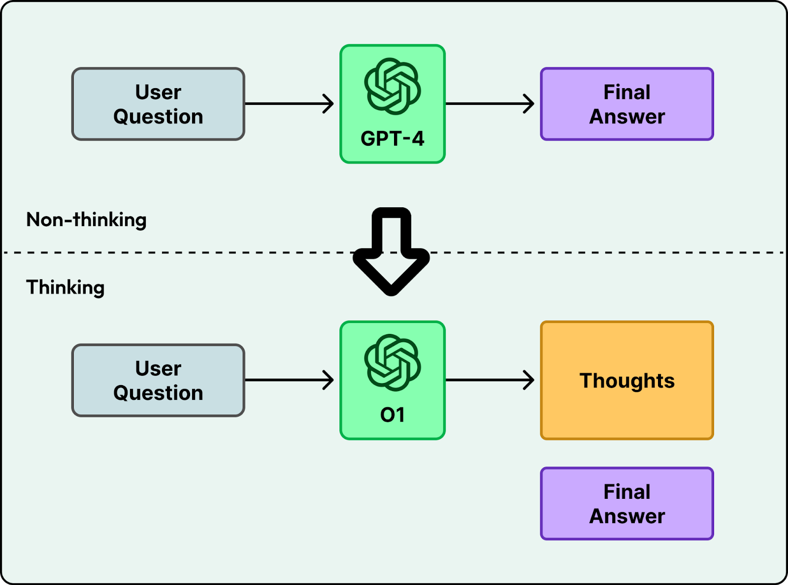
*Contrasts traditional single-pass generation (fixed token budget) with test-time reasoning (allocating dynamic compute to generate, evaluate, and search reasoning candidates before outputting).*

#### 2. Frontier Thinking & Reasoning Models Landscape
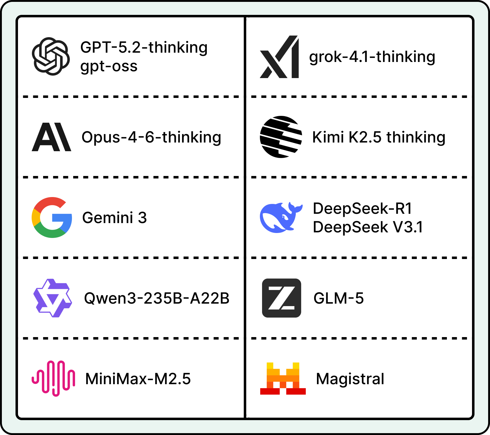
*Ecosystem of frontier reasoning models deploying test-time thinking: GPT-5.2-thinking, Opus-4-6-thinking, DeepSeek-R1, Kimi K2.5, Gemini 3, and Qwen3.*

#### 3. The 3-Stage LLM Training Pipeline
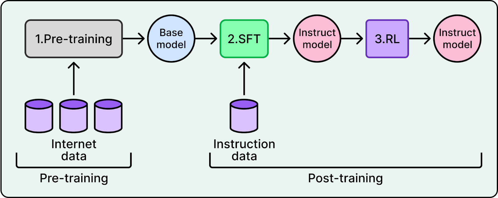
*The foundation model lifecycle: web-scale pre-training creates base models, supervised fine-tuning (SFT) yields instruction followers, and reinforcement learning (RL) aligns reasoning and behavior.*

#### 4. Traditional RLHF Alignment (Human Feedback)
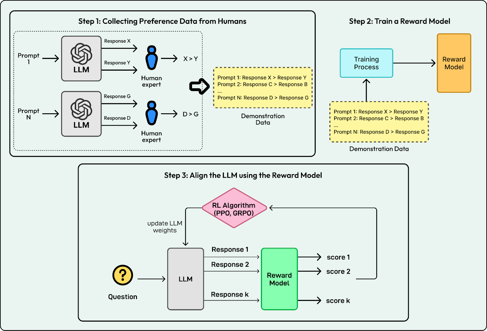
*Traditional alignment workflow: human annotators rank outputs to train a subjective Reward Model, which then guides policy optimization via PPO or GRPO (effective for tone, but limited for complex formal reasoning).*

#### 5. Modern RLVR Alignment (Verifiable Rewards)
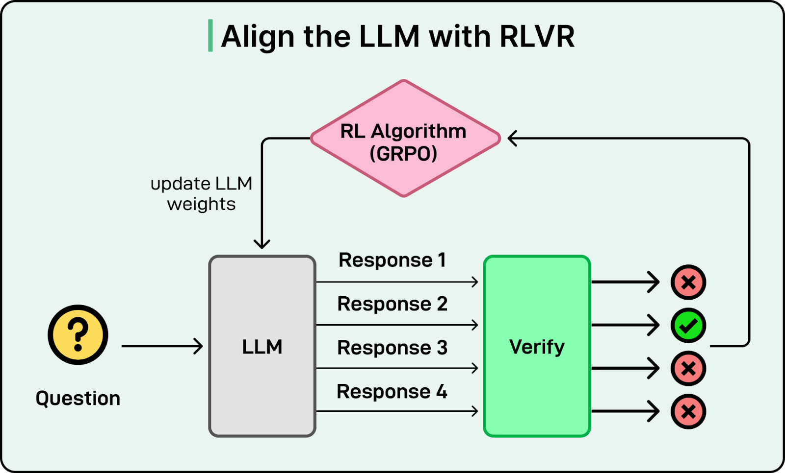
*The breakthrough behind reasoning models: replacing noisy human reward models with automated, deterministic verifiers (compilers, math solvers, unit tests) to reinforce valid multi-step thought paths via GRPO.*

### Technical Deep Dive: The Mechanics of Test-Time Reasoning & Post-Training Alignment

#### 1. Test-Time Compute Scaling vs. Pre-Training Scaling

Pre-training scaling laws (Kaplan et al., Chinchilla) established that model performance scales predictably with compute $C \approx 6 N D$, where $N$ is parameter count and $D$ is dataset tokens. However, as frontier pre-training approaches the public web data wall, **test-time compute scaling** introduces a parallel scaling dimension:

$$\text{Performance} \propto f(\text{Pre-training Compute}) + g(\text{Test-Time Search Compute})$$

During test time, instead of greedily predicting token-by-token in a single pass, reasoning models dynamically allocate search budget across:
- **Sequential Internal Deliberation:** Generating hidden Chain-of-Thought (CoT) tokens inside scratchpads to formulate hypotheses, verify edge cases, and self-correct prior missteps.
- **Search Topologies:** Running parallel rollouts via Monte Carlo Tree Search (MCTS), Beam Search, or Best-of-$N$ candidate sampling evaluated by Process-Supervised Reward Models (PRMs).

#### 2. Traditional RLHF vs. Direct Preference Optimization (DPO) vs. Modern RLVR (GRPO)

| Dimension | Traditional RLHF (PPO) | Direct Preference Optimization (DPO) | Reinforcement Learning with Verifiable Rewards (RLVR & GRPO) |
|:---|:---|:---|:---|
| **Reward Signal** | Subjective human preference scores ($1–5$ scale) | Implicit reward derived analytically from preference pairs $(y_w \succ y_l)$ | Deterministic, automated binary ground-truth verifiers: unit tests, math proofs, compiler success ($r \in \{0, 1\}$) |
| **VRAM / Network Footprint** | Massive: Requires 4 models in memory (Actor $\pi_\theta$, Reference $\pi_{\text{ref}}$, Critic $V_\phi$, Reward $R_\psi$) | Minimal: 2 models (Policy $\pi_\theta$ and Reference $\pi_{\text{ref}}$) | Highly Optimized: Eliminates critic network entirely by normalizing rewards within rollout groups ($G \approx 4–8$) |
| **Susceptibility to Reward Hacking** | High (Goodhart's Law: models learn sycophancy, excessive verbosity, and polite filler) | Moderate (Prone to out-of-distribution hallucinations on long-horizon reasoning) | Virtually Zero in formal domains (Code must pass real unit tests; proofs must execute) |
| **Primary Domain Suitability** | Conversational tone, safety guardrails, brand alignment | General instruction following, chat persona tuning | Formal logic, competitive programming, math olympiads, multi-file refactoring, agent planning |

#### 3. Mathematical Formulation of Group Relative Policy Optimization (GRPO)

Popularized by frontier reasoning architectures (e.g. DeepSeek-R1, QwQ) to democratize reasoning model alignment without requiring a compute-heavy critic/value model network, GRPO samples a group of $G$ candidate completions $\{o_1, o_2, \dots, o_G\}$ from the old policy $\pi_{\theta_{\text{old}}}$ for each question $q$, and optimizes the policy $\pi_\theta$ by maximizing:

$$\mathcal{J}_{\text{GRPO}}(\theta) = \mathbb{E}\left[ \frac{1}{G} \sum_{i=1}^G \left( \min\left( \frac{\pi_\theta(o_i|q)}{\pi_{\theta_{\text{old}}}(o_i|q)} \hat{A}_i, \text{clip}\left(\frac{\pi_\theta(o_i|q)}{\pi_{\theta_{\text{old}}}(o_i|q)}, 1-\epsilon, 1+\epsilon\right) \hat{A}_i \right) - \beta D_{\text{KL}}(\pi_\theta \| \pi_{\text{ref}}) \right) \right]$$

where the advantage $\hat{A}_i$ is computed relative to the mean and standard deviation of rewards within the sampled group:

$$\hat{A}_i = \frac{r_i - \text{mean}(\{r_1, \dots, r_G\})}{\text{std}(\{r_1, \dots, r_G\}) + \epsilon}$$

#### 4. The 2026 Frontier Shift: Hybrid Reasoning & Dynamic Thinking Budgets

Early reasoning models operated with fixed, opaque reasoning traces with high latency. Frontier 2026 models (such as **Claude 3.7 Sonnet**, **OpenAI o3/o3-mini**, and **Gemini 2.0 Flash Thinking**) introduce **Hybrid Reasoning**:
- **Dynamic Thinking Budgets:** API callers explicitly specify a `thinking_budget_tokens` parameter (from 0 to 128k tokens). A budget of 0 yields instant sub-second token generation for simple tasks, while setting high budgets unlocks deep multi-step verification for architectural planning and bug hunting.
- **Streaming Thought Visibility:** Reasoning traces stream token-by-token into designated XML blocks (`<thinking>...</thinking>`), enabling client-side progress bars and intermediate trajectory auditing before final output emission.

---

## 2. How the Math Used in 19th-Century Heat Physics Helps LLMs Understand Sentences
{: .d-inline-block }
13 Oct 2026
{: .label .label-purple }

**Architectural Summary:**  
Traces the mathematical lineage between Fourier's heat diffusion equations and modern transformer positional encodings, explaining how sinusoidal harmonic frequencies and Rotary Position Embeddings (RoPE) encode relative token order without destroying semantic invariant geometry.

### Key Diagrams

#### Positional Harmonics & RoPE
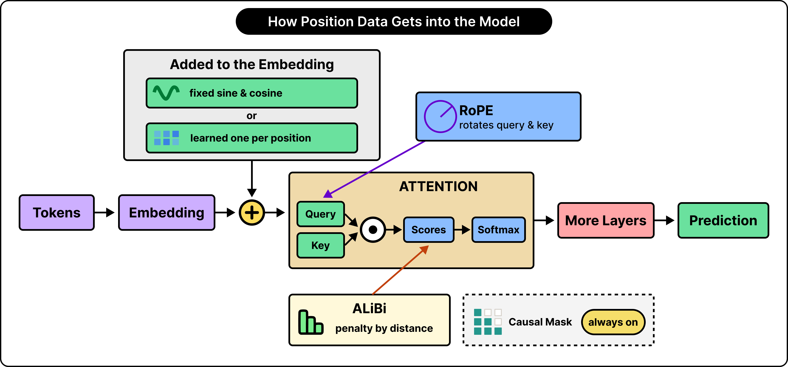
*Rotating query and key vector pairs in 2D coordinate planes to compute relative token distance via complex dot products.*

#### Sine-Cosine Harmonic Frequencies
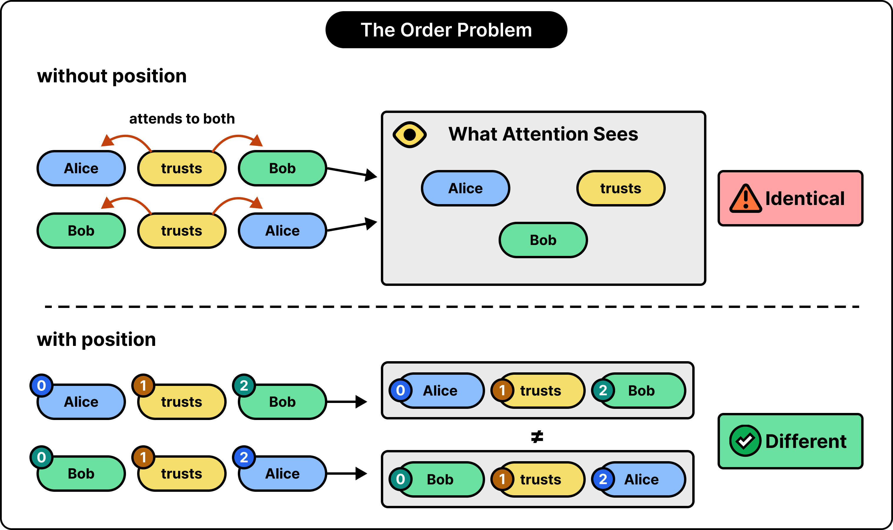
*Geometric progression of frequencies enabling models to generalize across long context windows.*

---

## 3. How to Build Models Without Language, with Logical Intelligence
{: .d-inline-block }
12 Oct 2026
{: .label .label-blue }

**Architectural Summary:**  
Contrasts token-by-token autoregressive LLMs with Energy-Based Models (EBMs) that perform non-autoregressive reasoning in continuous latent space, demonstrating how energy minimization and gradient-based inference solve combinatorial logic and constraint satisfaction at a fraction of LLM compute costs.

### Key Diagrams

#### Autoregressive LLM vs. Energy-Based Continuous Reasoning
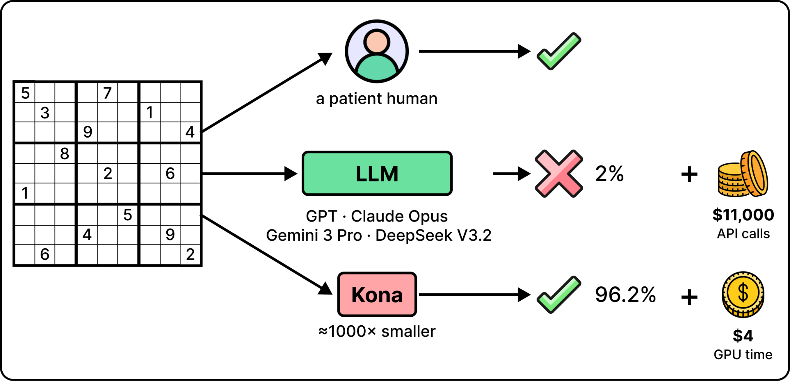
*Discrete token prediction vs. continuous energy surface minimization for constraint satisfaction.*

#### Gradient Descent Inference in Latent Space
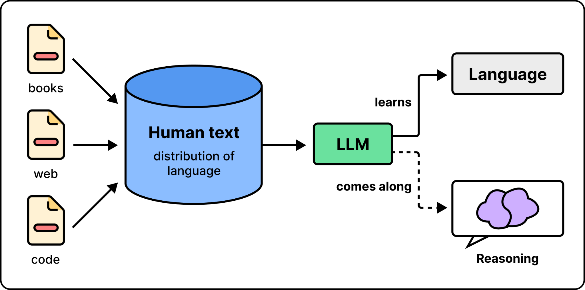
*Refining thoughts by descending energy gradients to settle into globally optimal solution states.*

---

## 4. How to Customize a Model to Learn New Tricks
{: .d-inline-block }
23 Sep 2026
{: .label .label-green }

**Architectural Summary:**  
Details parameter-efficient fine-tuning techniques (PEFT), breaking down low-rank adaptation matrix decomposition (LoRA) and 4-bit quantized adaptation (QLoRA) to specialize foundation models on domain tasks while drastically reducing GPU VRAM requirements.

### Key Diagrams

#### LoRA Matrix Factorization
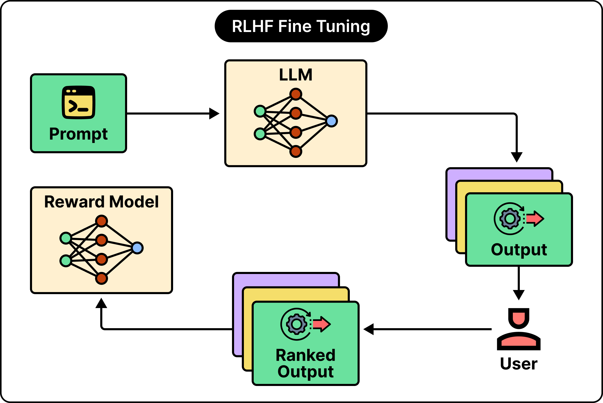
*Decomposing high-dimensional weight updates into low-rank matrices $A$ and $B$ ($d \times r$ and $r \times d$) where $r \ll d$.*

#### QLoRA 4-bit NormalFloat (NF4) Architecture
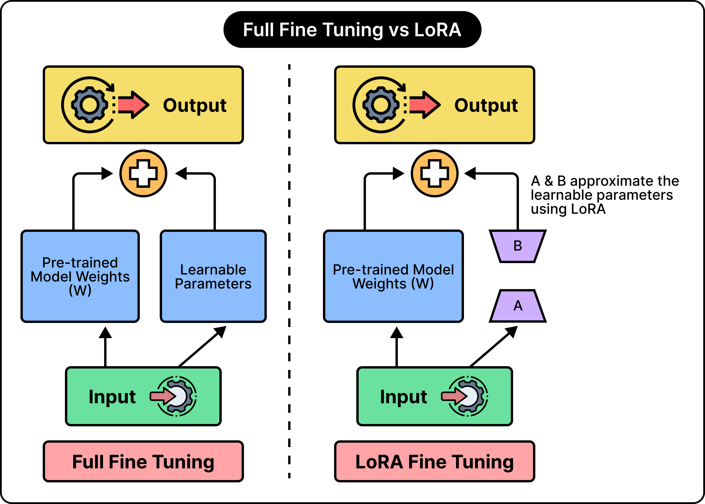
*Quantizing base weights to 4-bit NormalFloat while backpropagating gradients into 16-bit LoRA adapter matrices.*

---

## 5. How to Run a Big Model on Cheap Hardware?
{: .d-inline-block }
21 Sep 2026
{: .label .label-yellow }

**Architectural Summary:**  
Comprehensive engineering handbook on local and edge LLM inference, analyzing post-training quantization (FP16 down to INT4), layer-wise GPU/CPU/RAM offloading, Mixture-of-Experts sparse routing, KV-cache memory budgeting, and speculative decoding acceleration.

### Key Diagrams

#### Layer-Wise GPU & CPU Offloading
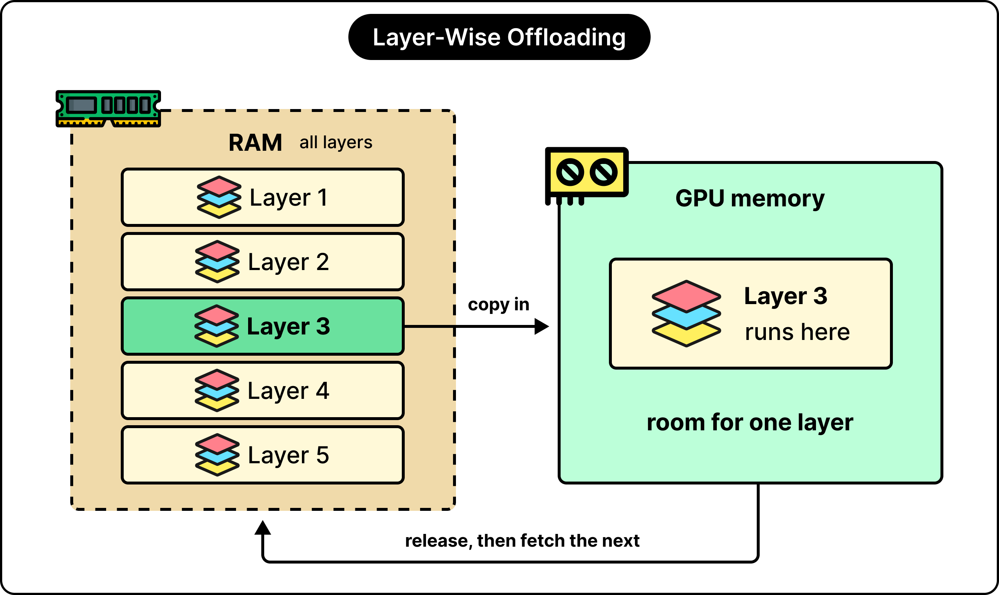
*Streaming transformer layers between host system RAM and GPU VRAM via PCIe to run models exceeding VRAM limits.*

#### MoE Sparse Expert Routing
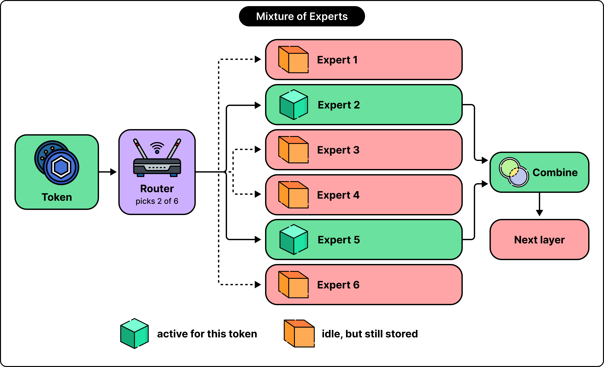
*Activating only top-k expert subnetworks per token to decouple total parameter capacity from compute cost.*

---

## 6. How Smart Model Routing Can Cut LLM Costs by 10X
{: .d-inline-block }
09 Sep 2026
{: .label .label-purple }

**Architectural Summary:**  
Details production model routing architectures that partition incoming prompts across tiered LLMs, comparing SLM classification gateways, cascading fallback verification, semantic vector similarity routing, and learned contextual bandits to cut inference costs by up to 90%.

### Key Diagrams

#### Dynamic Model Routing Dispatcher Architecture
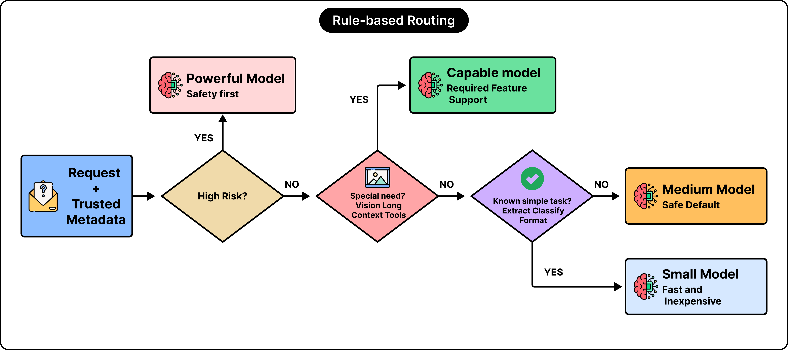
*Central gateway inspecting prompt complexity, token length, and latency SLAs to select the optimal model tier.*

#### Cascading Fallback & Verification Loop
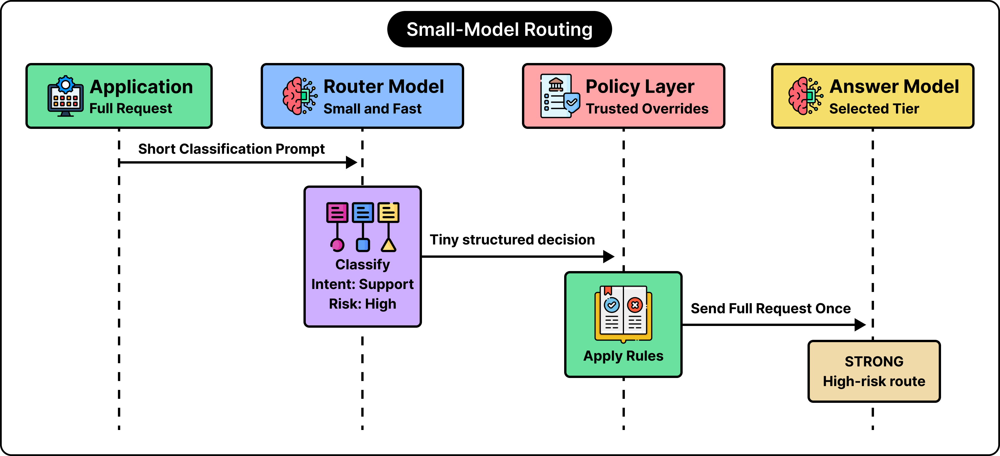
*Fast, cheap SLM generates initial candidate; output quality is verified before optionally escalating to frontier models.*

---

## 7. How to Shrink a Language Model Without Making it Too Dumb
{: .d-inline-block }
01 Sep 2026
{: .label .label-red }

**Architectural Summary:**  
Deep dives into the triad of model compression—post-training quantization (scale factor mapping and INT8/INT4 rounding), structured/unstructured pruning, and teacher-student knowledge distillation with soft-target cross-entropy—to shrink multi-gigabyte models for constrained inference.

### Key Diagrams

#### Quantization, Pruning, and Distillation Trio
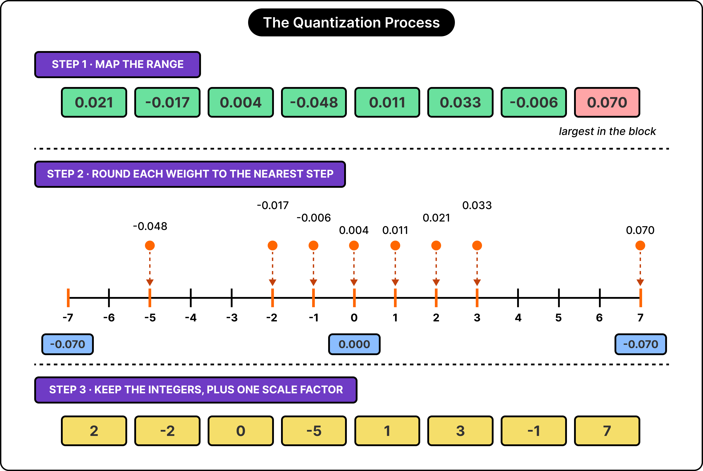
*Complementary compression techniques to reduce memory footprint, eliminate redundant weights, and transfer reasoning.*

#### Teacher-Student Knowledge Distillation
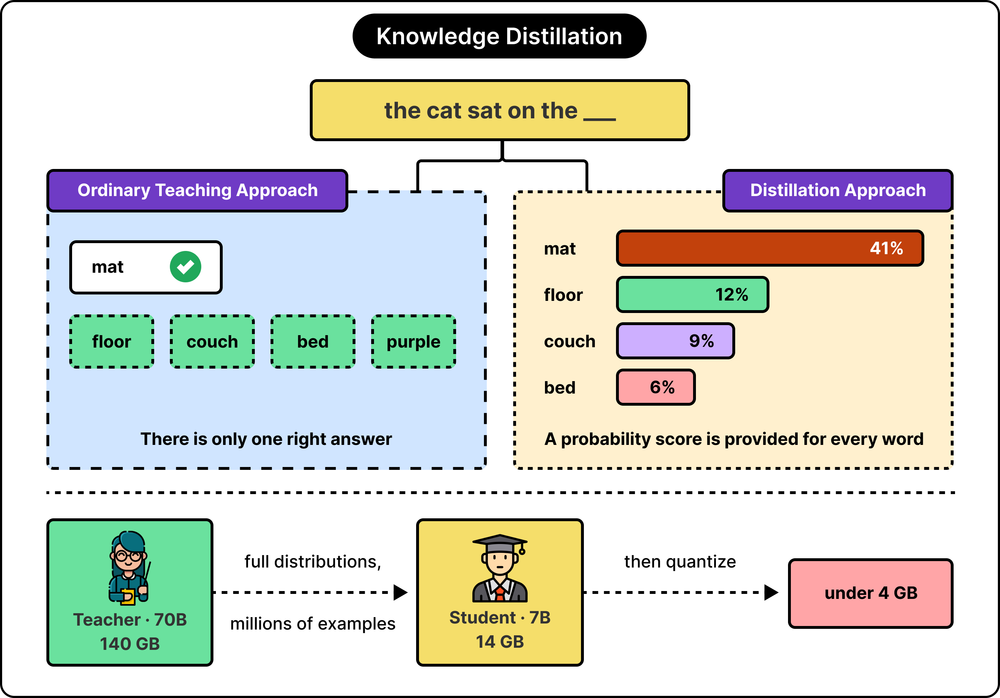
*Training a lightweight student model on the softened probability distribution logits generated by a massive teacher model.*

---

## 8. What Happens Inside an AI Chatbot Between Enter and the First Word?
{: .d-inline-block }
31 Aug 2026
{: .label .label-blue }

**Architectural Summary:**  
Unpacks the end-to-end request execution lifecycle of modern LLM serving engines, mapping the architectural transition from compute-bound parallel prompt prefill to memory-bandwidth-bound autoregressive decoding, continuous GPU batching, and KV-cache reuse.

### Key Diagrams

#### Prefill (Compute-Bound) vs. Decode (Memory-Bound) Phases
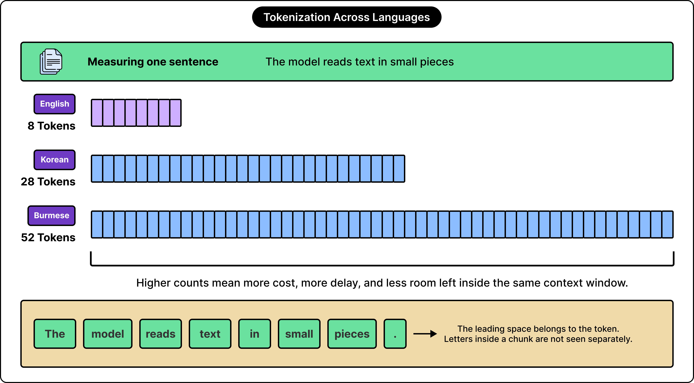
*Why prompt ingestion saturates Tensor Core compute (high arithmetic intensity) while generation stalls on VRAM memory bandwidth.*

#### Continuous GPU Batching Architecture
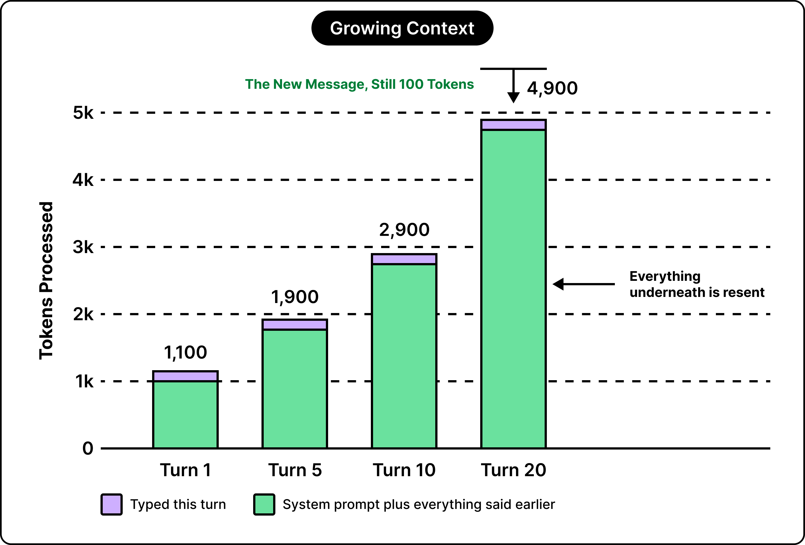
*Dynamically inserting new incoming requests at each token iteration step to maximize GPU utilization without waiting for sequence completion.*

---

## 9. How to Make LLMs 3X Faster
{: .d-inline-block }
26 Aug 2026
{: .label .label-green }

**Architectural Summary:**  
Unpacks speculative decoding mechanics, explaining how small auxiliary draft models (or Medusa multi-head decoders) propose candidate token sequences verified concurrently by the target model in a single memory-bandwidth pass with lossless mathematical distribution guarantees.

### Key Diagrams

#### Parallel Verification Pass
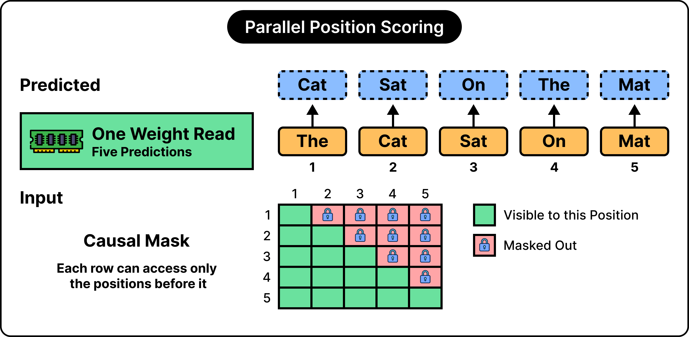
*Frontier model evaluates all candidate draft tokens simultaneously using causal mask attention.*

#### Draft-Verify Rejection Sampling Loop
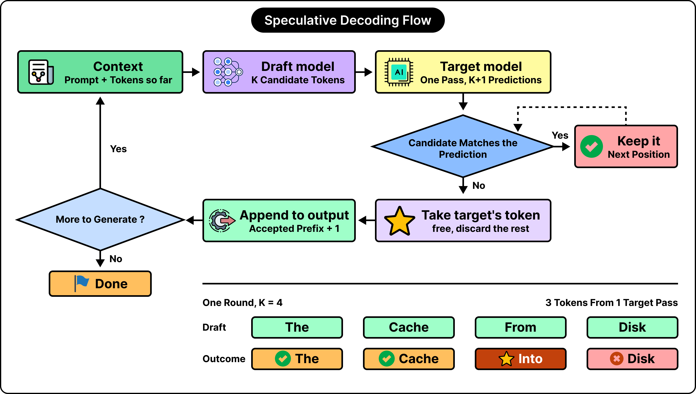
*Rejection sampling guarantees the generated sequence matches the target model's probability distribution identically.*

---

## 10. EP223: Ollama vs vLLM vs SGLang
{: .d-inline-block }
22 Aug 2026
{: .label .label-purple }

**Architectural Summary:**  
Evaluates the three dominant open-weight inference serving engines—Ollama (developer ease via llama.cpp backend), vLLM (high-throughput PagedAttention server), and SGLang (RadixAttention tree-structured KV cache reuse for complex structured/agentic outputs)—alongside Claude's pseudorandom logit watermarking algorithm.

### Key Diagram

#### Comparative Architecture: Ollama vs. vLLM vs. SGLang
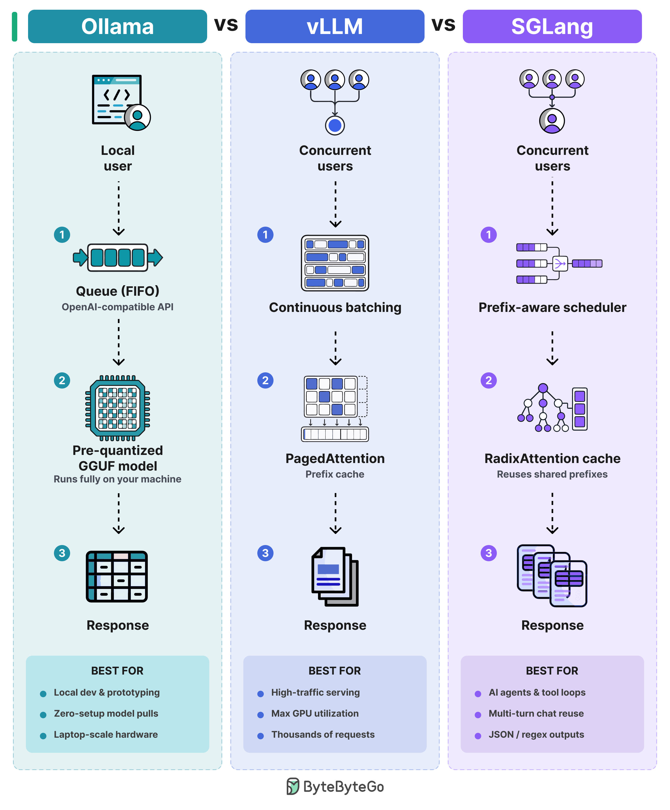
*Evaluating memory management, execution runtimes, batching algorithms, and multi-GPU serving scaling.*

---

## 11. The New American AI Model Designed to be Customized
{: .d-inline-block }
18 Aug 2026
{: .label .label-yellow }

**Architectural Summary:**  
Dissects Thinking Machines' (Mira Murati) Inkling architecture, detailing its 66-layer hybrid design featuring 256 fine-grained MoE experts (activating only 6 per token), interleaved local sliding-window attention, short token-mixing convolutions, and modular fine-tuning surfaces.

### Key Diagrams

#### Inkling Hybrid Model Overview
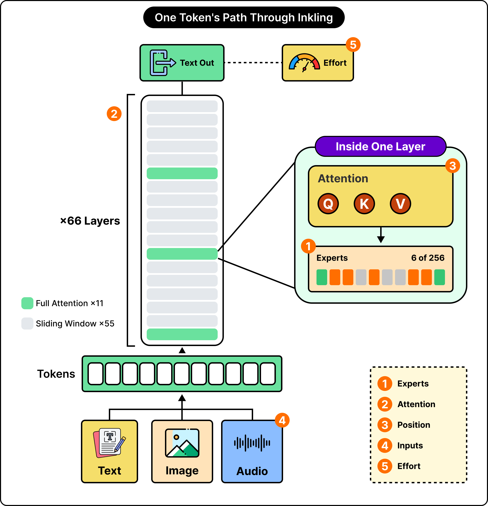
*Interleaving dense self-attention with ultra-sparse MoE blocks and local token-mixing convolutions.*

#### Fine-Grained MoE Sparsity
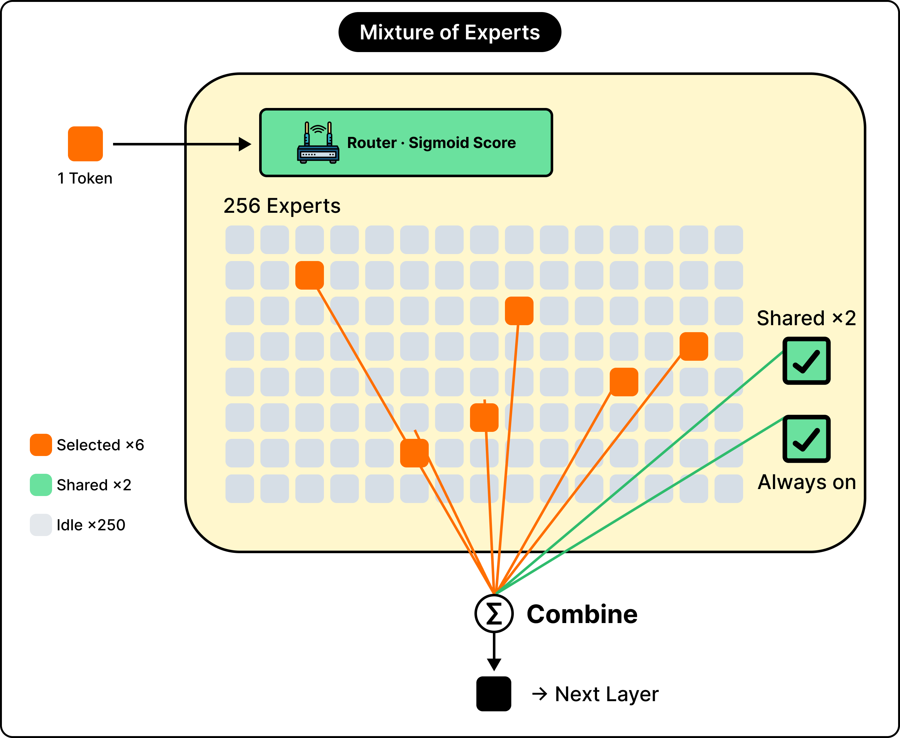
*Routing tokens across 256 micro-experts to isolate specialized domains and reduce parameter activation.*

---

## 12. EP222: What is Google’s TPU?
{: .d-inline-block }
15 Aug 2026
{: .label .label-blue }

**Architectural Summary:**  
Details the microarchitecture of Google’s Tensor Processing Unit (TPU), contrasting general-purpose GPU execution with TPU Matrix Multiply Units (MXUs) that use systolic arrays to stream matrix products directly between registers without intermediate memory access.

### Key Diagram

#### Google TPU Systolic Array Microarchitecture
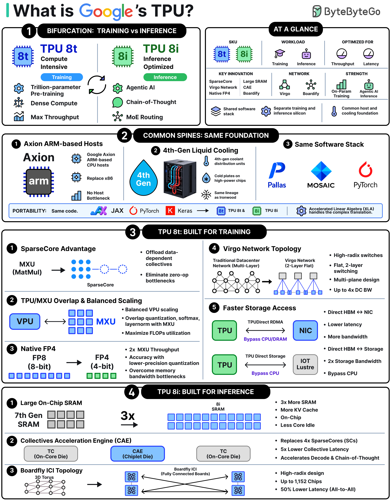
*2D grid of processing elements streaming weights and data directly across adjacent registers to eliminate memory bus stalls.*

---

## 13. How Big Models Teach Small Models to Be Smart
{: .d-inline-block }
05 Aug 2026
{: .label .label-green }

**Architectural Summary:**  
Details the mathematical and architectural pipeline of knowledge distillation, examining how student models learn from teacher "soft labels" and temperature-scaled logits to capture dark knowledge relationships across tokens while retaining 90%+ accuracy at 10x lower inference latency.

### Key Diagrams

#### Hard Labels vs. Soft Logit Labels
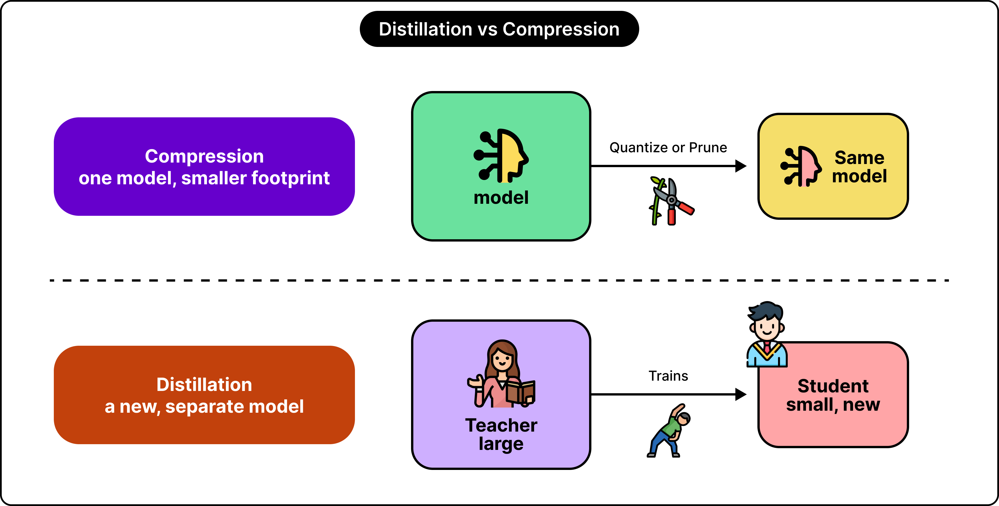
*How probability distributions over non-target tokens convey rich structural and semantic relationships.*

#### Temperature Scaling in Softmax
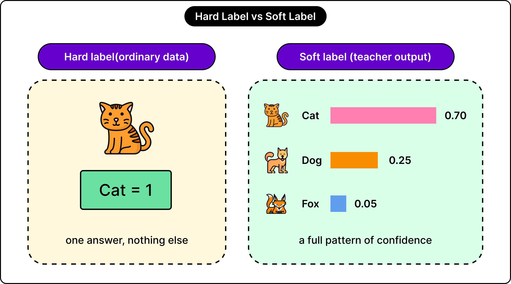
*Raising temperature $T$ to smooth peak logits and expose fine-grained dark knowledge representations.*

---

## 14. Why An LLM’s Memory Gets Expensive and How to Fix It
{: .d-inline-block }
04 Aug 2026
{: .label .label-purple }

**Architectural Summary:**  
Breaks down why KV-cache memory consumes the majority of GPU VRAM during long-context serving, detailing structural fixes including Grouped-Query Attention (GQA), FP8/INT4 KV quantization, attention sinks/eviction policies, and PagedAttention virtual memory mapping.

### Key Diagrams

#### Multi-Head vs. Multi-Query vs. Grouped-Query Attention
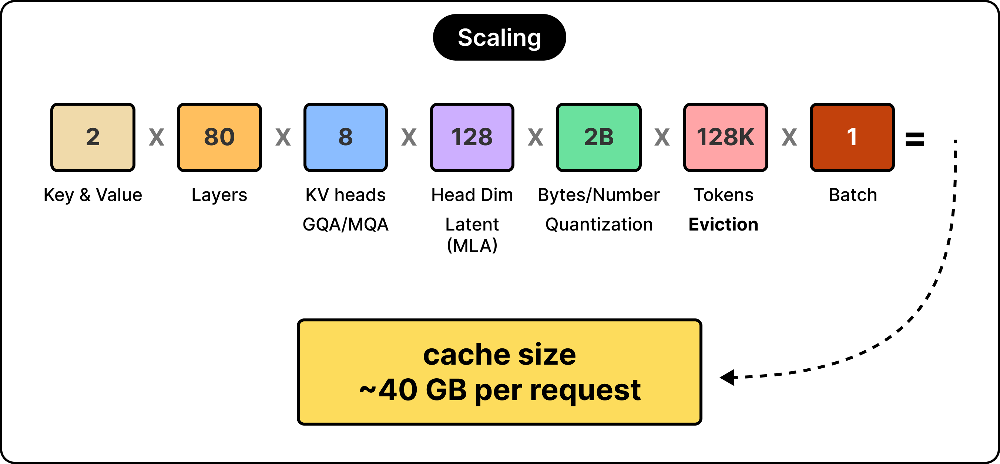
*Sharing key and value projection heads across query head groups to slash KV-cache footprint by up to 8x.*

#### PagedAttention Virtual Memory Mapping
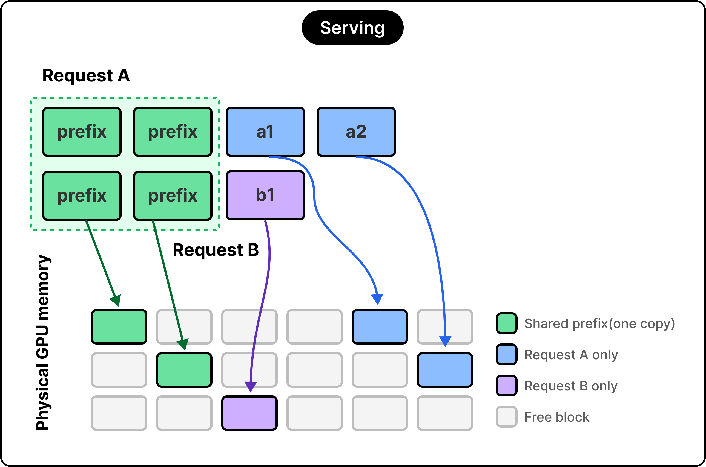
*Allocating non-contiguous physical GPU VRAM blocks via virtual page tables to eliminate internal memory fragmentation.*

---

## 15. How NVIDIA Builds Open Models for the Age of AI
{: .d-inline-block }
27 Jul 2026
{: .label .label-blue }

**Architectural Summary:**  
Features an in-depth interview with NVIDIA's VP of Applied Deep Learning Research Bryan Catanzaro, explaining NVIDIA's open model strategy (Nemotron/Cosmos), hardware-software co-design for Tensor Core FP8/FP4 precision, and hybrid Mamba-Transformer SSM architectures that slash linear memory complexity.

### Key Diagrams

#### Hybrid Mamba-Transformer State Space Model (SSM)
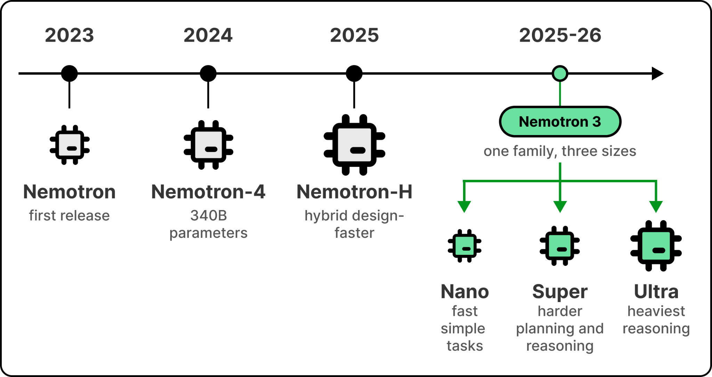
*Combining linear-time state space token mixing with selective self-attention layers to process infinite context.*

#### Hardware-Software Co-Design for Tensor Cores
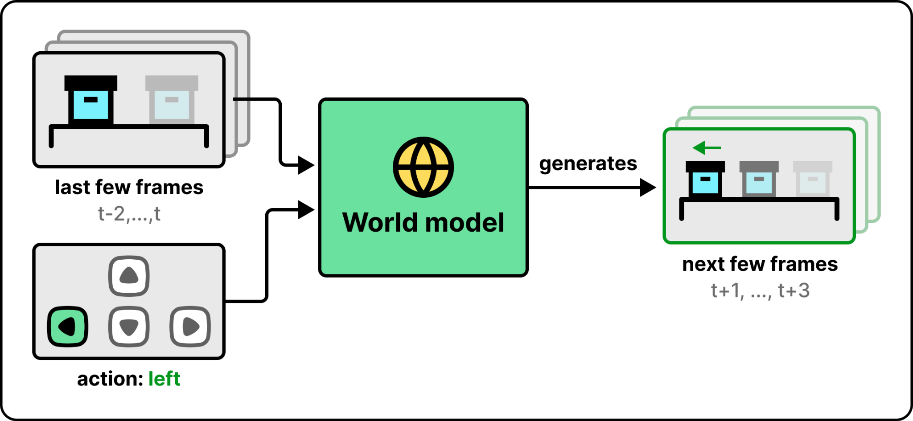
*Aligning model layer widths and tensor formats directly with Blackwell Tensor Core FP4 matrix instructions.*

---

## 16. How LLMs Learn to Be Helpful (RLHF vs DPO)
{: .d-inline-block }
14 Jul 2026
{: .label .label-green }

**Architectural Summary:**  
Explores post-training preference alignment architectures, detailing how pre-trained and fine-tuned base models are aligned using Reinforcement Learning from Human Feedback (RLHF with PPO), Direct Preference Optimization (DPO's closed-form mathematical policy), and Reinforcement Learning with Verifiable Rewards (RLVR) to avoid reward hacking while aligning models with human values.

### Key Diagrams

#### RLHF with PPO vs. Direct Preference Optimization (DPO)
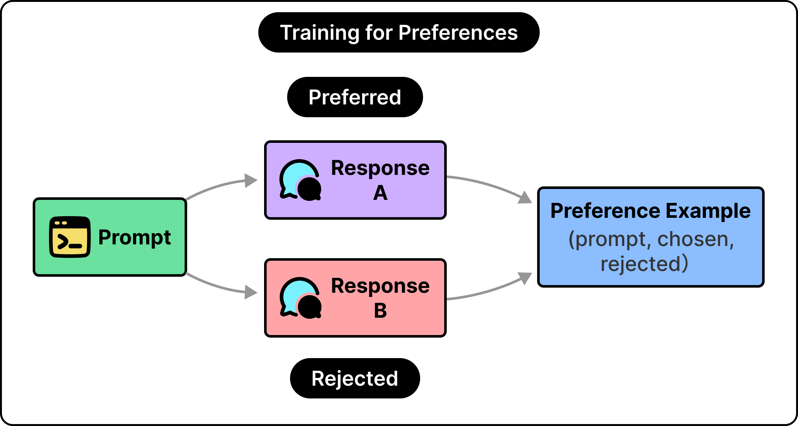
*Comparing multi-model actor-critic reward training against DPO's direct parameter optimization without explicit reward models.*

#### Mitigating Reward Hacking with KL Penalty
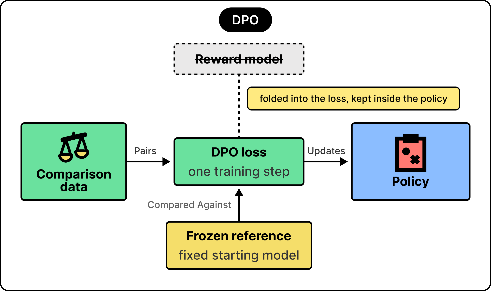
*Constraining policy drift relative to the frozen reference model to prevent optimization collapse.*

---

## 17. ChatGPT vs Gemini vs Claude: How They Differ
{: .d-inline-block }
07 Jul 2026
{: .label .label-yellow }

**Architectural Summary:**  
Contrasts the core architectural forks across frontier LLMs, analyzing Dense vs Sparse Mixture-of-Experts (MoE) parameter scaling, native multimodal sensor fusion vs modular projection, context window scaling and degradation mitigation, and inference-time thinking tokens (routed vs adaptive reasoning).

### Key Diagrams

#### Architectural Forks Across Frontier Models
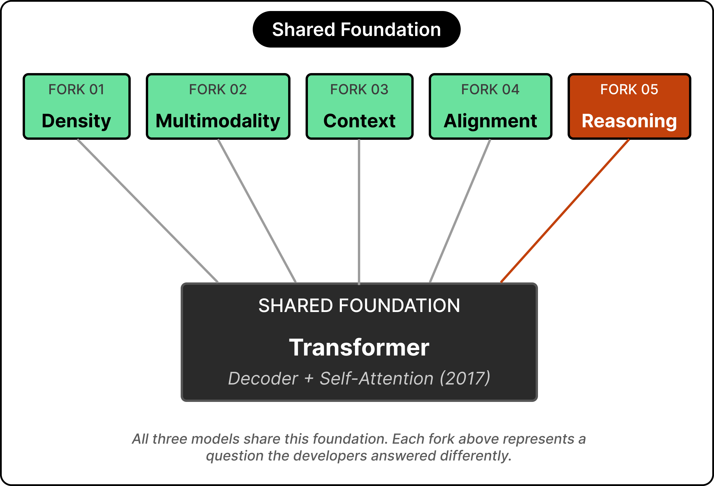
*Comparing parameter routing, reasoning pipelines, and multimodal tokenization across OpenAI, Google, and Anthropic.*

#### Dense vs. Sparse MoE Density
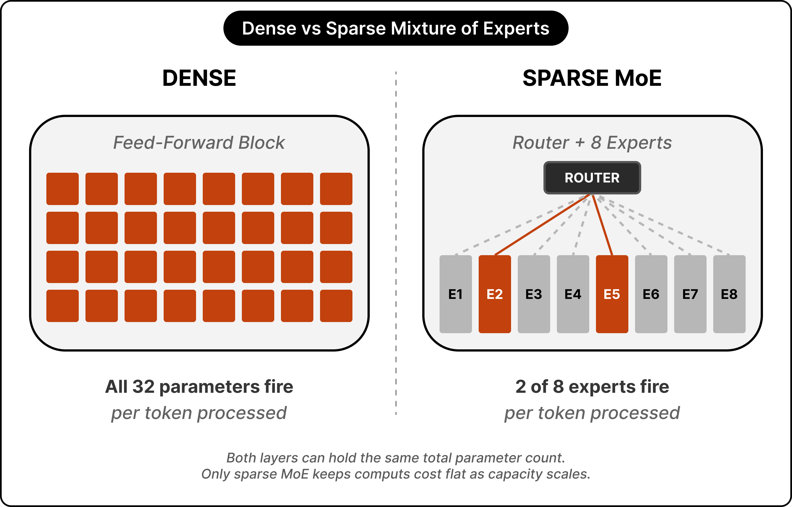
*Comparing dense monolithic computation against sparse dynamic routing across hundreds of specialized experts.*

---

## 18. Large Language Models vs Small Language Models
{: .d-inline-block }
24 Jun 2026
{: .label .label-purple }

**Architectural Summary:**  
Examines the architectural split between cloud datacenter LLMs and edge/device Small Language Models (SLMs), detailing KV-cache cross-layer sharing, Quantization-Aware Training (QAT), Chinchilla overtraining compute trade-offs, and hybrid hierarchical orchestration.

### Key Diagrams

#### Datacenter vs. Edge Constraints
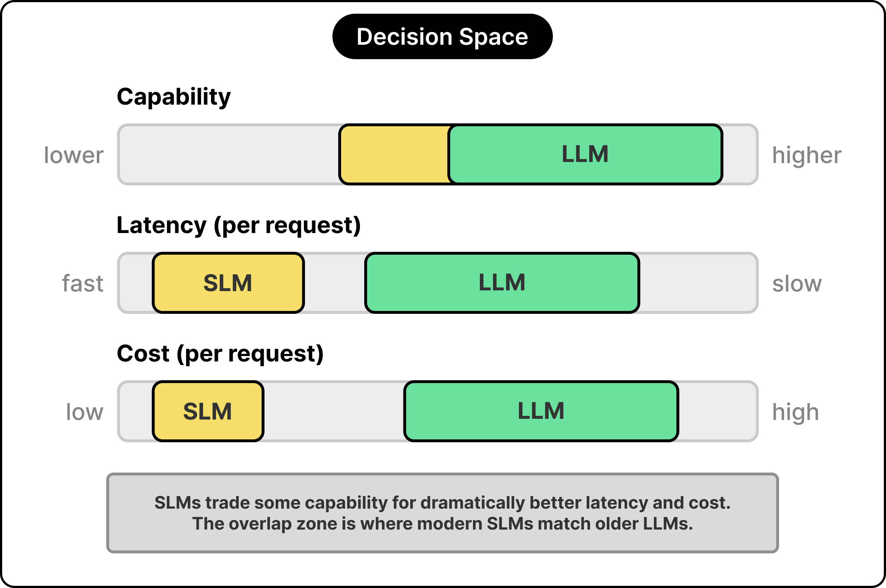
*Balancing latency, thermal limits, battery power, and memory bandwidth across client devices.*

#### Post-Training Quantization (PTQ) vs. Quantization-Aware Training (QAT)
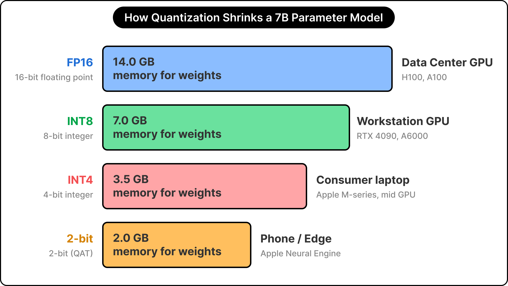
*Simulating low-precision rounding errors during training to maintain high accuracy at INT4 weights.*

---

## 19. EP219: 12 Open-source LLMs
{: .d-inline-block }
20 Jun 2026
{: .label .label-blue }

**Architectural Summary:**  
Visual reference guide and taxonomy comparing 12 leading open-weight LLMs (Llama 3, Mistral, Gemma, DeepSeek, Qwen, Falcon, Phi, Command R+, StarCoder), dissecting parameter scales, architecture types (Dense vs MoE), license terms, and SLM vs LLM serving characteristics.

### Key Diagrams

#### 12 Open-Source LLMs Cheat Sheet
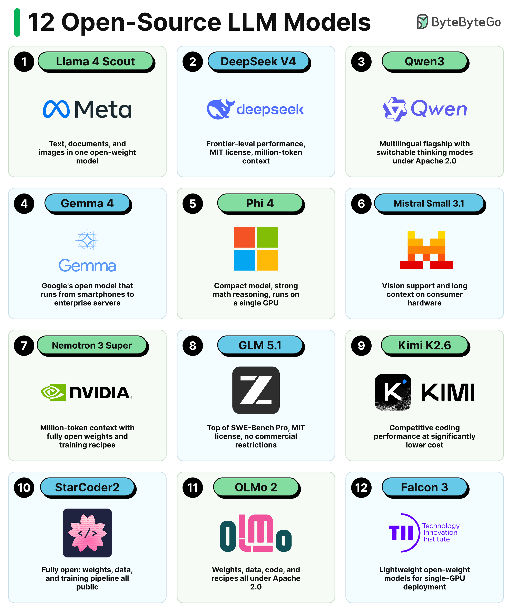
*Matrix evaluating license permissiveness, parameter counts, native context windows, and base architectures.*

#### SLMs vs. LLMs Clearly Explained
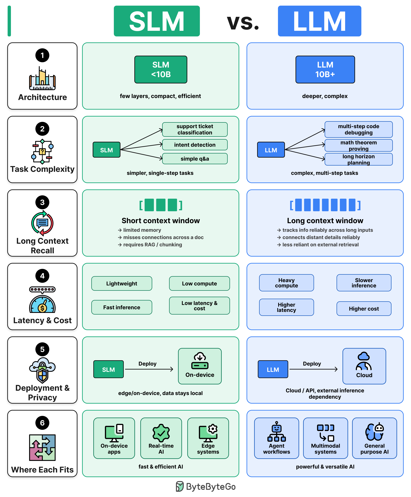
*Trade-off analysis between edge low-latency SLMs and centralized frontier datacenter models.*

---

## 20. How Open-Weight Models Changed the AI Landscape
{: .d-inline-block }
16 Jun 2026
{: .label .label-green }

**Architectural Summary:**  
Dissects open-weight model architectures and the borrow-and-build innovation transfer cycle, detailing sparse MoE block routing, attention variants (MHA vs GQA vs Sliding Window Attention), and end-to-end training pipelines across open models.

### Key Diagrams

#### Attention Strategies: MHA vs. GQA vs. Sliding Window
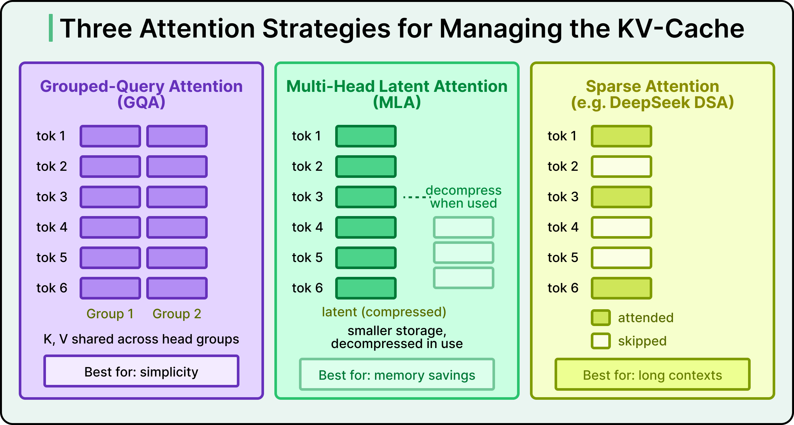
*Contrasting full quadratic self-attention with grouped-query memory reduction and localized window attention.*

#### Open-Source Training Pipeline Stages
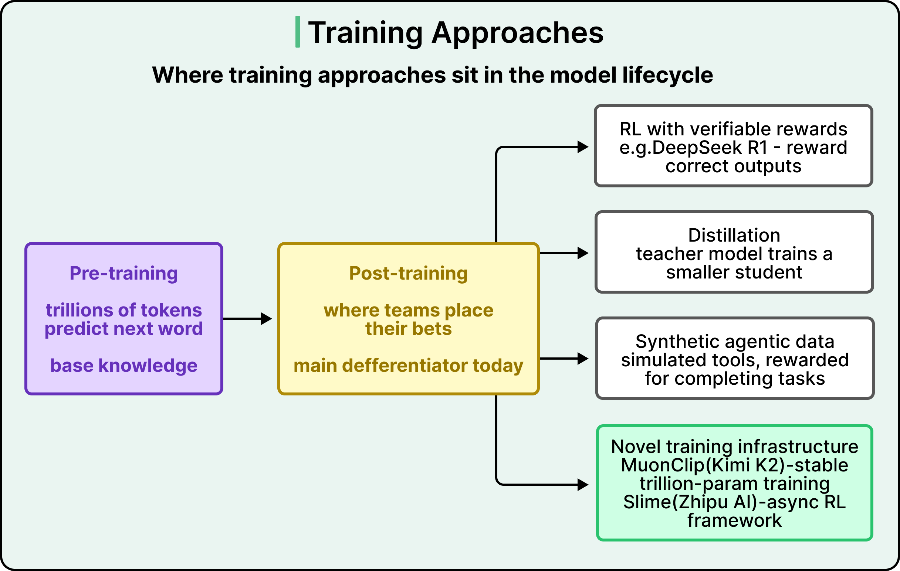
*Pre-training data filtering -> Unsupervised prefill -> Instruction tuning -> DPO/RLVR alignment.*

---

## 21. A Guide to AI Inference Engineering
{: .d-inline-block }
15 Jun 2026
{: .label .label-yellow }

**Architectural Summary:**  
In-depth guide to production inference engineering, dissecting the metrics that govern LLM serving (TTFT prefill vs TPS decode), latency-throughput Pareto tradeoffs, prefix caching with KV reuse, speculative decoding under load, and distributed multi-GPU parallelism (Tensor, Pipeline, and Expert Parallelism).

### Key Diagrams

#### Prefill (TTFT) vs. Decode (TPS)
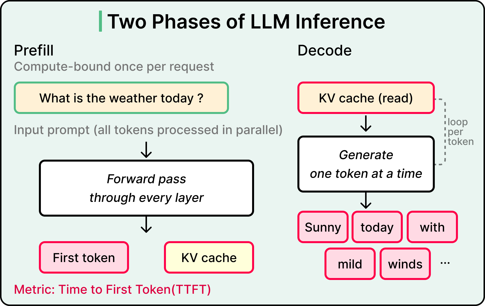
*Time to First Token (TTFT) prefill latency vs. inter-token decoding throughput (Tokens Per Second).*

#### Prefix Caching & KV-Cache Reuse
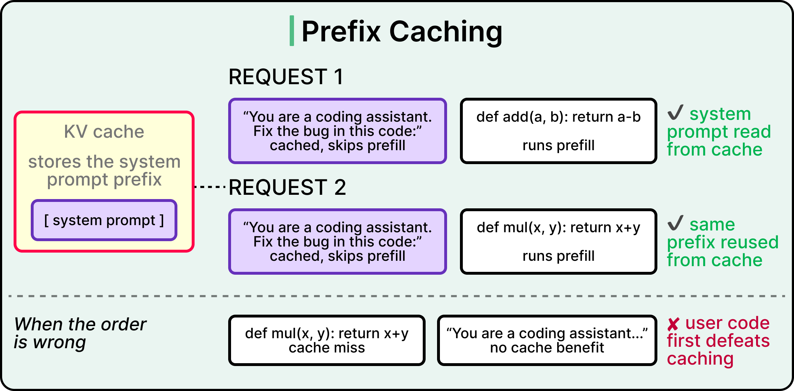
*Hashing prompt prefixes to reuse existing KV cache blocks across shared system prompts and multi-turn conversations.*

---

## 22. Token Spend Out of Control? The Case for Smarter Routing
{: .d-inline-block }
08 Jun 2026
{: .label .label-red }

**Architectural Summary:**  
Comprehensive guide on production LLM cost optimization through intelligent request routing, breaking down multi-turn context compounding, unified provider abstractions, heuristic vs learned classifier routing, and background chore offloading.

### Key Diagrams

#### Compounding Context Growth in Agent Loops
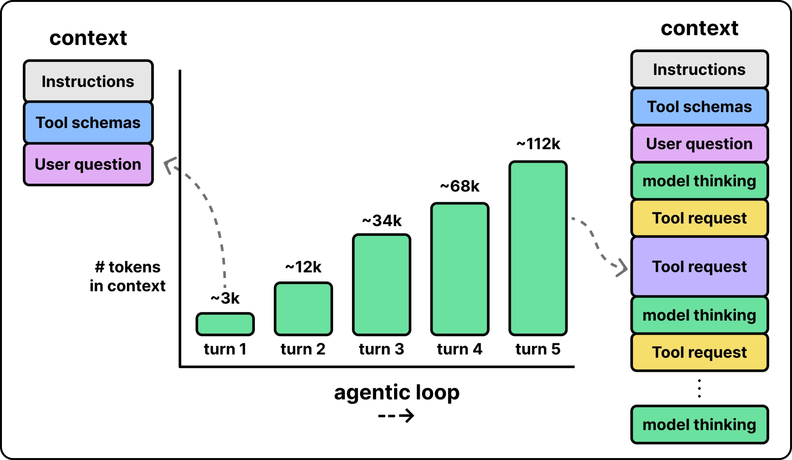
*Why multi-turn tool loops cause quadratic token expenditure if prompts are not dynamically compacted or routed.*

#### Dynamic Router Architecture
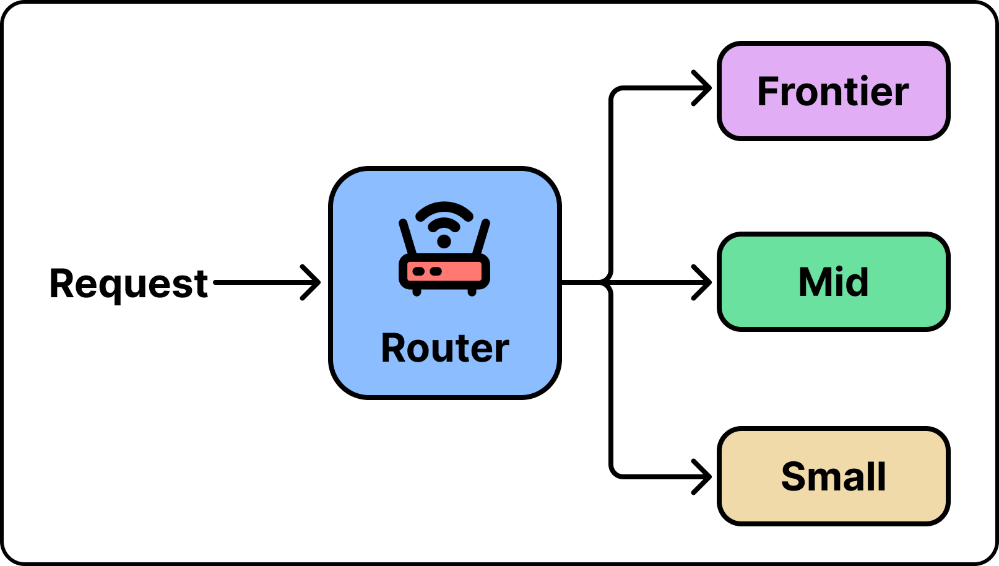
*Classifying task requirements and routing low-complexity steps to distilled models.*

---

## 23. EP205: CPU vs GPU vs TPU
{: .d-inline-block }
07 Mar 2026
{: .label .label-purple }

**Architectural Summary:**  
Contrasts computer hardware architectures for deep learning, analyzing CPU sequential low-latency execution, GPU massive SIMT thread parallelism and memory latency hiding, and TPU domain-specific systolic array tensor compute.

### Key Diagrams

#### CPU vs. GPU vs. TPU Hardware Comparison
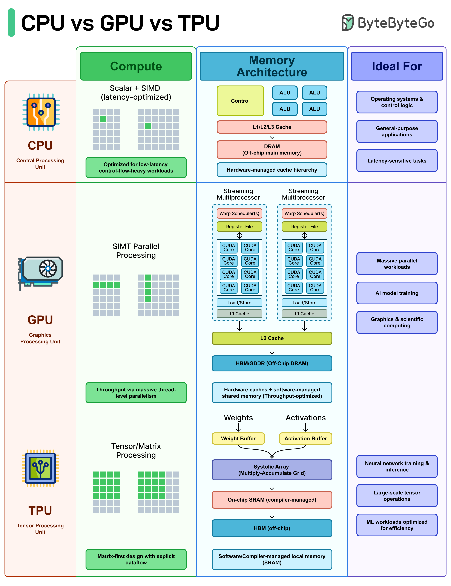
*Architecture comparison across latency, throughput, memory bandwidth, and programming models.*

#### GPU Latency Hiding via Massive Thread Warps
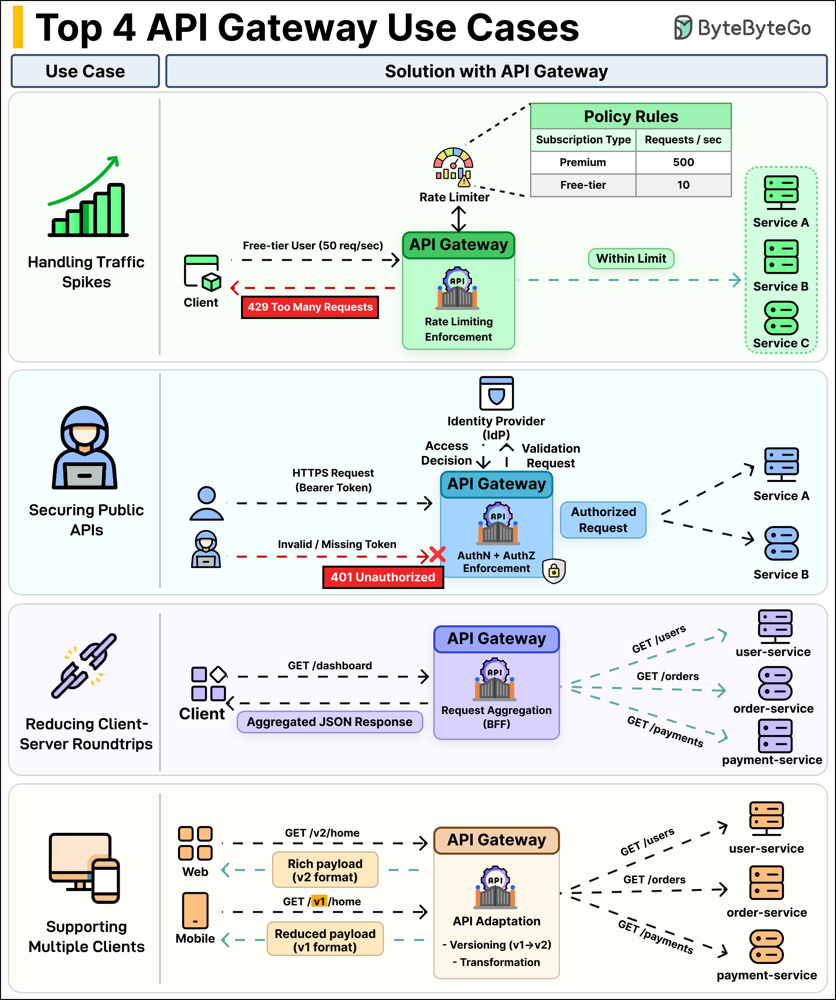
*Swapping stalled warps waiting on memory fetch for active computation threads.*

---

## 24. The Architecture Behind Open-Source LLMs
{: .d-inline-block }
02 Mar 2026
{: .label .label-blue }

**Architectural Summary:**  
Deep dive into the architectural innovations across modern open models, analyzing DeepSeek’s Multi-Head Latent Attention (MLA) low-rank KV compression, Meta Llama's GQA dense scaling, and Reinforcement Learning with Verifiable Rewards (RLVR).

### Key Diagrams

#### Multi-Head Latent Attention (MLA)
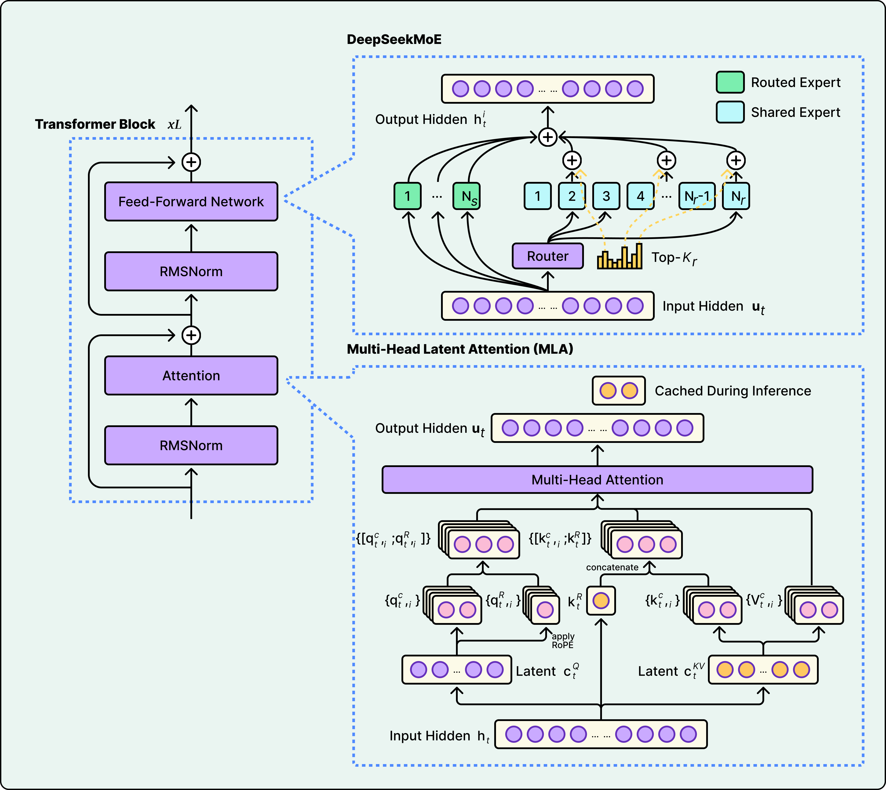
*Compressing key and value heads into a low-dimensional latent vector to reduce KV-cache memory consumption by 90%.*

#### RLVR Verifiable Rewards Pipeline
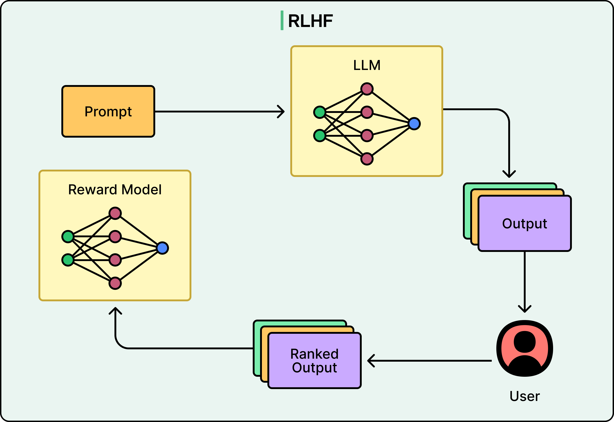
*Training reasoning models using deterministic unit-test pass/fail signals.*

---

## 25. How Large Language Models Learn
{: .d-inline-block }
23 Feb 2026
{: .label .label-green }

**Architectural Summary:**  
Breaks down the mathematical mechanics of neural network training, detailing cross-entropy loss calculation, automatic differentiation backpropagation, and stochastic gradient descent parameter adjustment loops.

### Key Diagrams

#### Backpropagation & Gradient Descent
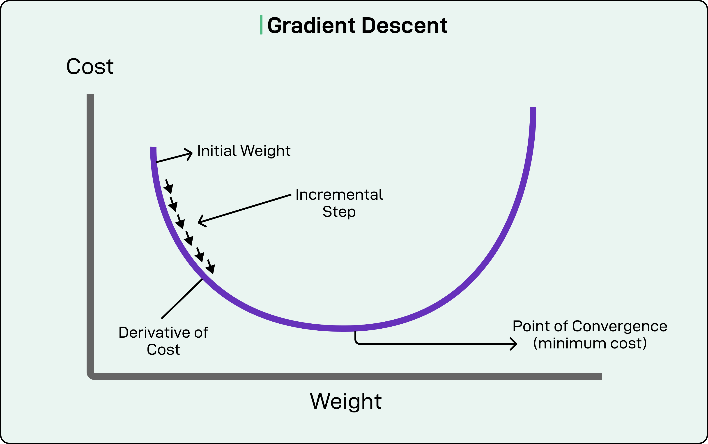
*Computing partial derivatives layer-by-layer to adjust weight tensors along the steepest descent direction.*

#### The Forward-Backward Training Cycle

*Forward pass token prediction -> Loss calculation -> Backward gradient propagation -> Optimizer weight step.*

---

## 26. How Transformers Architecture Powers Modern LLMs
{: .d-inline-block }
02 Feb 2026
{: .label .label-yellow }

**Architectural Summary:**  
Step-by-step technical breakdown of the Transformer architecture, detailing input token embeddings, scaled dot-product multi-head self-attention (Q, K, V), Feed-Forward Networks (FFN), layer normalization, and end-to-end execution.

### Key Diagrams

#### Complete Transformer Architecture Blueprint

*Detailed block diagram showing embedding lookup, multi-head attention, residual connections, and layer norms.*

#### Scaled Dot-Product Multi-Head Attention ($Q, K, V$)

*Mathematical sequence: $\text{Attention}(Q, K, V) = \text{softmax}\left(\frac{QK^T}{\sqrt{d_k}}\right)V$.*

---

## 27. Why AI Needs GPUs and TPUs: The Hardware Behind LLMs
{: .d-inline-block }
19 Jan 2026
{: .label .label-blue }

**Architectural Summary:**  
Explains the hardware architecture requirements of deep learning workloads, detailing the memory-compute Von Neumann bottleneck, 2D systolic array matrix multiplication flow, and floating-point formats (FP32, FP16, BF16, and INT8).

### Key Diagrams

#### Von Neumann Memory Bottleneck in Deep Learning

*Why shuttling weights across traditional memory buses stalls processor execution units.*

#### Floating-Point Formats: FP32 vs. FP16 vs. BF16

*Dynamic range vs precision bit-width trade-offs for high-throughput tensor processing.*

---

## 28. How Google’s Tensor Processing Unit (TPU) Works?
{: .d-inline-block }
05 Jan 2026
{: .label .label-purple }

**Architectural Summary:**  
Dissects Google's custom ASIC Tensor Processing Unit, detailing its weight-stationary matrix multiply unit (MXU), systolic array 2D dataflow, bfloat16 hardware support, and interconnect topology.

### Key Diagrams

#### TPU Matrix Multiply Unit (MXU) 2D Dataflow

*Pipelined systolic array where inputs flow horizontally and partial sums accumulate vertically.*

#### Google TPU Block Diagram

*High-level layout showing MXU, unified buffer, high-bandwidth memory (HBM), and vector processing unit.*

---

## 29. Multimodal LLMs Basics: How LLMs Process Text, Images, Audio & Videos
{: .d-inline-block }
22 Dec 2025
{: .label .label-green }

**Architectural Summary:**  
Architectural foundations of Multimodal Large Language Models (MLLMs), explaining how modality-specific encoders map visual, auditory, and textual inputs into a shared geometric embedding space via projection layers and cross-attention blocks.

### Key Diagrams

#### Multimodal MLLM Architecture Overview

*Unified blueprint covering vision encoders, audio codecs, projection adapters, and language backbones.*

#### Unified Vector Embedding Space

*Mapping heterogeneous data modalities into a common geometric vector space where related concepts align.*

---

## 30. The $250 Million Paper
{: .d-inline-block }
10 Dec 2025
{: .label .label-yellow }

**Architectural Summary:**  
Dissects the architecture of the open-weight Molmo vision-language model, analyzing its synthetic-free PixMo human-annotated dataset, visual grounding/pointing mechanism, and efficient cross-attention multi-modal projection.

### Key Diagram

#### Molmo Vision-Language Model Architecture

*End-to-end architecture showing visual patch extraction, connector projection, and language generation.*

---

## 31. How LLMs Learn from the Internet: The Training Process
{: .d-inline-block }
01 Dec 2025
{: .label .label-purple }

**Architectural Summary:**  
Comprehensive breakdown of the end-to-end foundation model training pipeline, from raw web scraping and heuristic quality filtering to BPE subword tokenization, unsupervised autoregressive pre-training, SFT, and RLHF reward alignment.

### Key Diagrams

#### End-to-End Foundation Model Training Lifecycle

*Five stages: Web data collection, Subword tokenization, Unsupervised pre-training, SFT, and Preference alignment.*

#### Loss Landscape & Gradient Descent

*Visualizing multi-dimensional parameter optimization across loss surfaces.*

---

## 32. EP187: Why is DeepSeek-OCR such a BIG DEAL?
{: .d-inline-block }
01 Nov 2025
{: .label .label-blue }

**Architectural Summary:**  
Analyzes DeepSeek-OCR's architectural breakthrough in extreme visual document compression, demonstrating how visual tokenizers compress high-resolution documents into a fraction of traditional token counts while preserving OCR fidelity.

### Key Diagram

#### DeepSeek-OCR Context Compression Architecture

*Compressing visual pages into dense latent tokens to allow entire book-length documents in a single context window.*

---

## 33. What Actually Happens When You Press ‘Send’ to ChatGPT
{: .d-inline-block }
20 Oct 2025
{: .label .label-green }

**Architectural Summary:**  
Step-by-step trace of a prompt's execution path inside ChatGPT's infrastructure: API gateway routing, content moderation guardrails, high-dimensional vector embeddings lookup, autoregressive decoding loop with KV caching, and dynamic tool orchestration.

### Key Diagrams

#### ChatGPT Infrastructure Architecture

*High-level system topology: CDN/WAF -> Gateway -> Orchestrator -> Inference Engine -> Tools.*

#### The Autoregressive Decoding Loop

*Iterative token generation loop: Forward pass -> Logit calculation -> Temperature sampling -> Output emission.*

---

## 34. How Fine-Tuning Transforms Generic AI Models into Specialists
{: .d-inline-block }
24 Sep 2025
{: .label .label-purple }

**Architectural Summary:**  
Deep dive into domain specialization of pre-trained models, contrasting full parameter fine-tuning, instruction tuning, Low-Rank Adaptation (LoRA), and 4-bit Quantized LoRA (QLoRA) to preserve base knowledge while adapting to specific enterprise tasks.

### Key Diagrams

#### Fine-Tuning Decision Framework Matrix

*Trade-off guide: Choosing between In-Context Prompting, RAG, LoRA, and Full Fine-Tuning based on compute and latency budgets.*

---

## 35. How LLMs See Images, Audio, and More
{: .d-inline-block }
18 Aug 2025
{: .label .label-yellow }

**Architectural Summary:**  
Deep architectural exploration of multimodal tokenization strategies across modalities, analyzing Vision Transformer (ViT) patch extraction, discrete codebooks (VQ-VAE / VQGAN), continuous contrastive embeddings (CLIP), and neural audio codecs (SoundStream / EnCodec RVQ).

### Key Diagrams

#### Vision Transformer (ViT) Patch Extraction

*Flattening 2D images into linear sequences of non-overlapping $16 \times 16$ pixel patches treated as visual words.*

#### Neural Audio Codecs & Residual Vector Quantization (RVQ)

*Quantizing audio waveforms into hierarchical multi-stream discrete token codes.*

---

## 36. How LLMs See the World
{: .d-inline-block }
04 Aug 2025
{: .label .label-blue }

**Architectural Summary:**  
Deep dive into the foundational role of tokens in language models, comparing Byte-Pair Encoding (BPE), WordPiece, and Unigram tokenization algorithms while examining edge-case vulnerabilities, mathematical reasoning degradation, and tokenization artifacts.

### Key Diagrams

#### Tokens Rule the World

*How subword tokenization acts as the fundamental translation lens between human language and neural embeddings.*

#### Tokenization Artifacts & Edge-Case Failure Modes

*Why subword fragmentation causes arithmetic calculation errors and spelling sensitivity.*
