# RAG, Vector Search & Retrieval
{: .no_toc }

Comprehensive quick reference covering GraphRAG, Agentic RAG control loops, embedding model design, multi-tenant vector partitioning (Airtable Milvus), distributed SQL vector indexing (CockroachDB C-SPANN), and enterprise multimodal search.

## Table of Contents
{: .no_toc .text-delta }

1. TOC
{:toc}

---

## 1. The End-to-End RAG Application Stack
{: .d-inline-block }
RAG Foundations
{: .label .label-purple }

**Architectural Summary:**  
Deconstructs the complete lifecycle of production Retrieval-Augmented Generation (RAG) systems across six core architectural stages: multi-format document ingestion, semantic chunking and metadata enrichment, dense vector embedding generation, high-dimensional vector database persistence and indexing, similarity/hybrid retrieval, and context-augmented prompt synthesis with guardrails.

### Key Diagrams

#### End-to-End RAG Application Stack
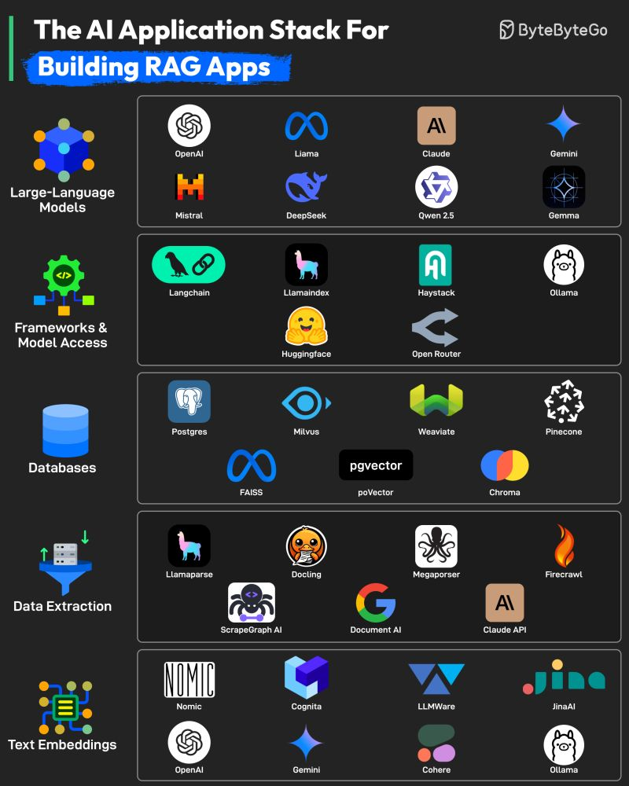
*Complete multi-tier RAG architecture: ingestion pipeline, chunking, embedding generation, vector indexing, retrieval routing, and LLM context synthesis.*

---

## 2. GraphRAG: How AI Answers Questions Hidden Across Many Documents
{: .d-inline-block }
19 Aug 2026
{: .label .label-purple }

**Architectural Summary:**  
Overcomes standard vector similarity limits on corpus-wide aggregation by extracting knowledge graphs from text, clustering nodes via Leiden community detection into hierarchical summaries, and supporting both Local Search (entity neighborhood traversal) and Global Search (map-reduce over community reports) via agentic routing.

### Key Diagrams

#### Standard RAG Indexing vs. Graph Construction

*Linear chunk-and-embed pipeline compared against structured entity, claim, and relationship extraction.*

#### Similarity Search Limitations on Global Questions
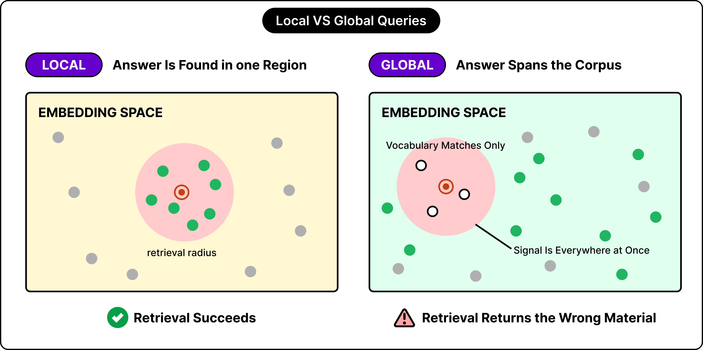
*Why vector cosine distance excels at localized needles in haystacks but fails completely on holistic corpus-wide questions.*

#### Knowledge Graph Construction Pipeline
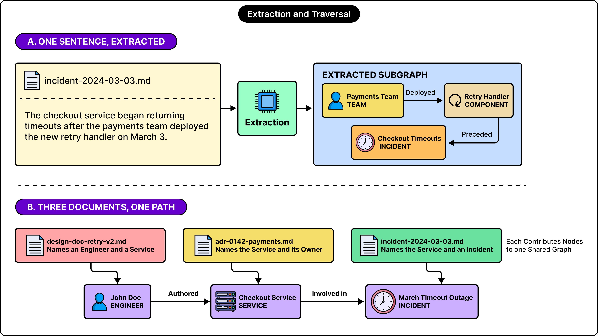
*Extracting entities, relationships, and source claims from document chunks to build a connected knowledge graph.*

#### Graph Provenance & Text Pointers
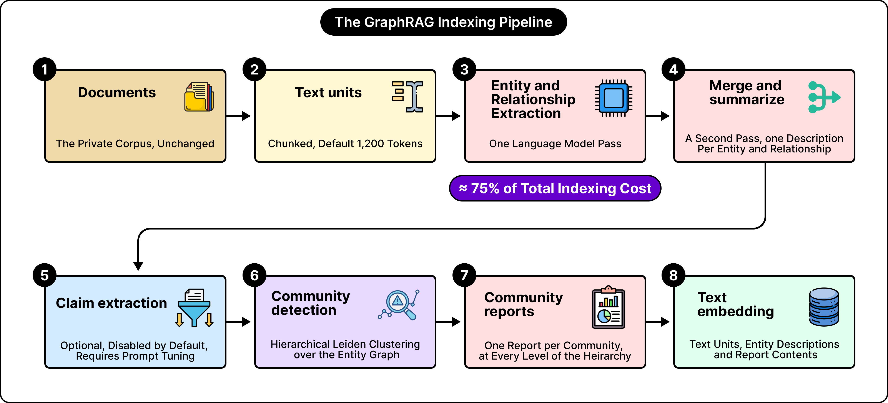
*Enforcing strict grounding by linking every entity node and relationship edge back to exact chunk offsets in source text.*

#### Hierarchical Community Detection (Leiden)
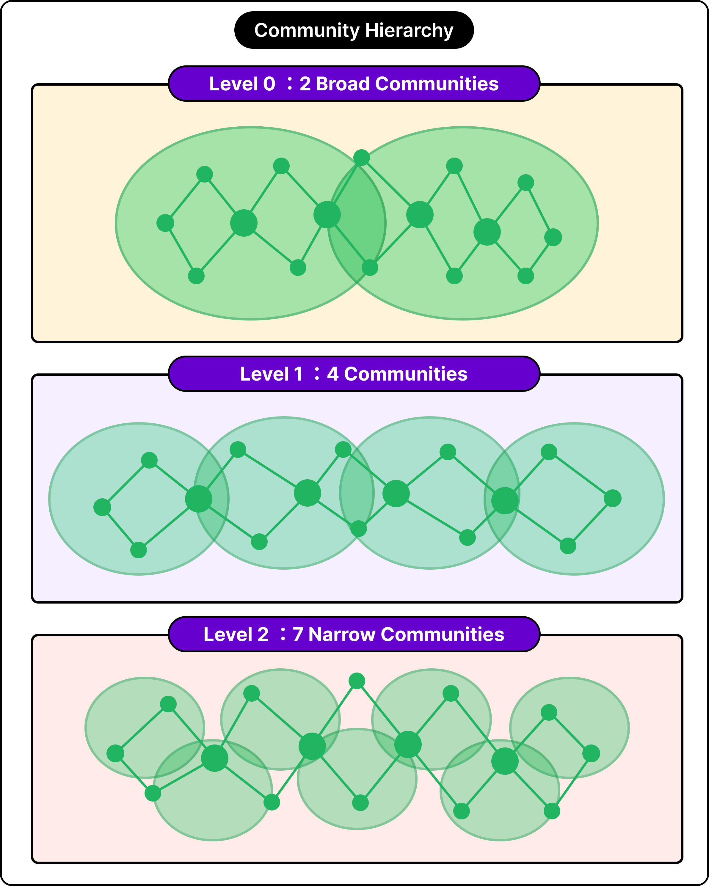
*Clustering knowledge graph partitions from high-level global themes (C0/C1) down to granular sub-topics (C2/C3).*

#### Local vs. Global Search Modes
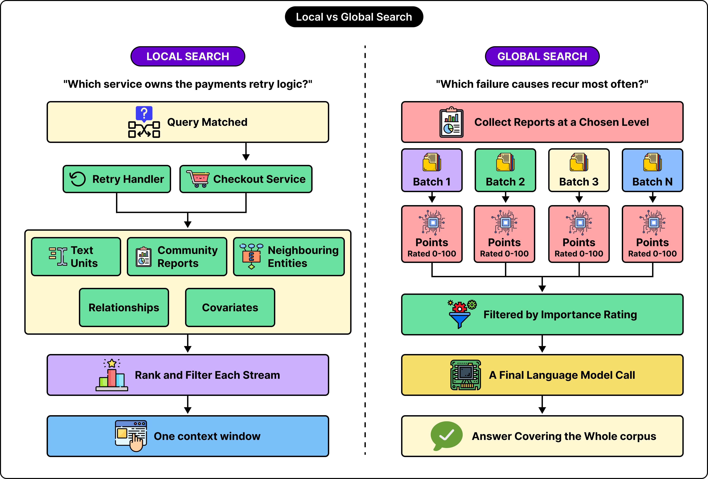
*Query routing: Local Search queries entity subgraphs; Global Search performs parallel map-reduce over community summary reports.*

#### Agentic Retrieval Router
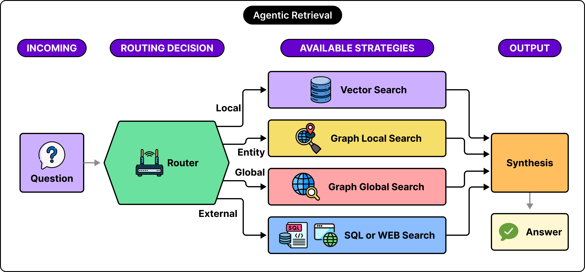
*LLM router classifying user prompts to dispatch either Standard RAG, Local GraphRAG, or Global Community Search.*

---

## 3. Why Your RAG System Is Only as Good as Its Translator Model
{: .d-inline-block }
02 Sep 2026
{: .label .label-blue }

**Architectural Summary:**  
Argues that RAG accuracy is fundamentally bounded by the quality and domain alignment of the embedding model rather than generator LLM capacity, detailing indexing vs. retrieval stages, semantic search failure modes, the high re-indexing cost of model migration, and Matryoshka Representation Learning (MRL) storage designs.

### Key Diagrams

#### Separating Knowledge Retrieval from Language Generation
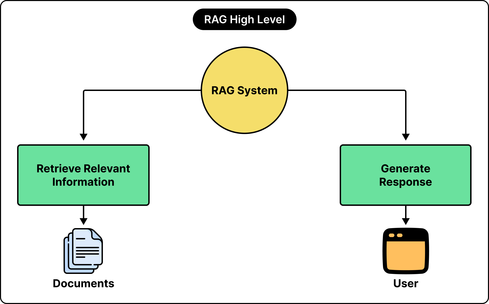
*Clear architectural separation: The embedding retriever determines context relevance; the LLM only formats the retrieved context.*

#### The Indexing Phase Pipeline
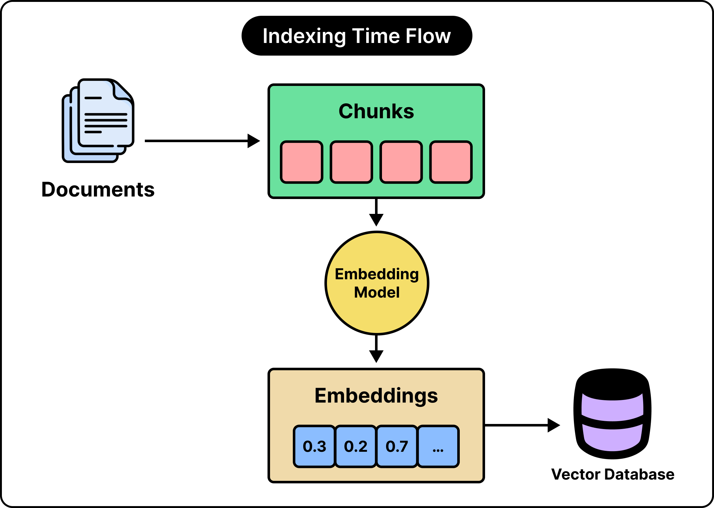
*Document preprocessing, token chunking, embedding generation via translator model, and dense vector persistence.*

#### The Retrieval Phase Pipeline
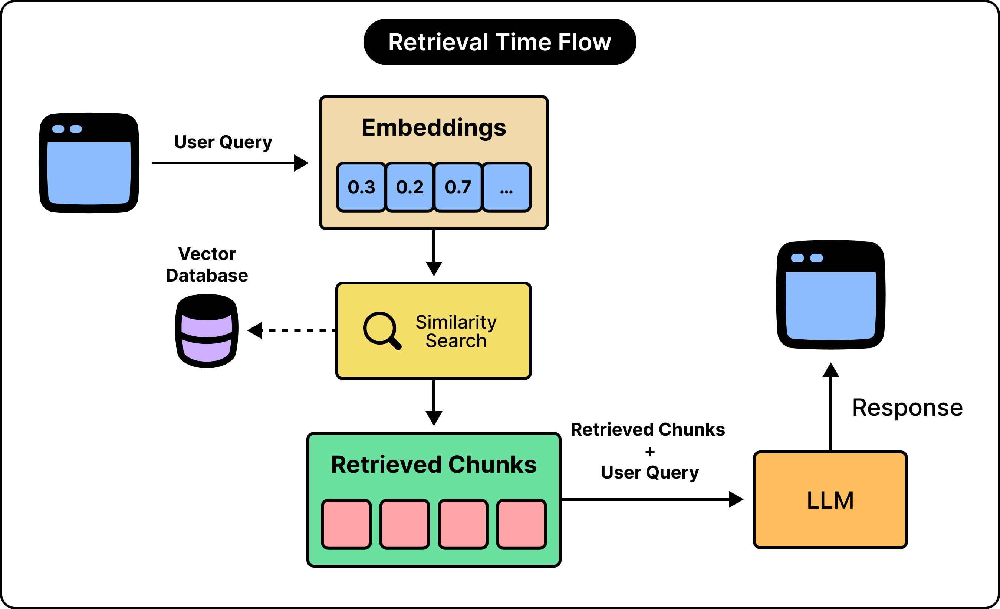
*Query embedding transformation, top-k vector similarity search, re-ranking, and dynamic prompt augmentation.*

#### Semantic Similarity Pitfalls
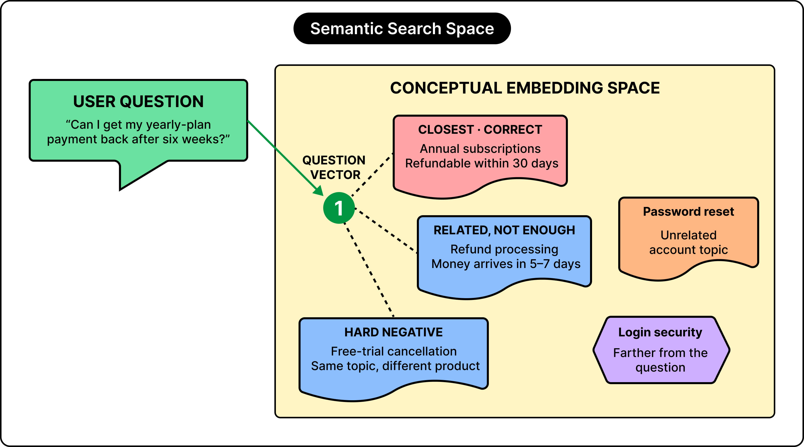
*Failure modes where cosine similarity matches topical keywords rather than answering the user's specific operational question.*

#### The High Migration Cost of Switching Embeddings
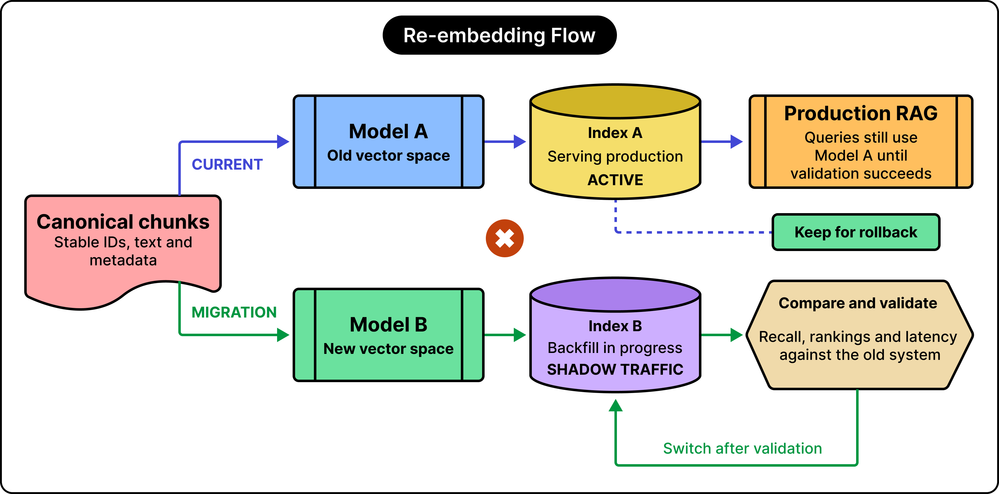
*Why swapping embedding models requires re-computing vectors across millions of documents and invalidates existing indexes.*

#### Matryoshka Representation Learning (MRL) Storage Designs
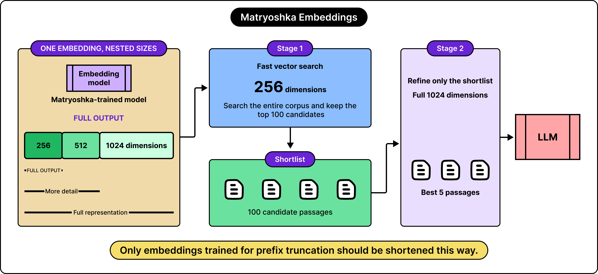
*Three multi-tier vector sizing layouts: Slicing embeddings dynamically to trade minor precision drops for massive memory savings.*

---

## 4. EP220: RAG vs Graph RAG vs Agentic RAG
{: .d-inline-block }
27 Jun 2026
{: .label .label-green }

**Architectural Summary:**  
Contrasts the three primary retrieval paradigms—Standard RAG (single-turn semantic vector search for localized queries), Graph RAG (community-clustered knowledge graph traversals for global dataset summaries), and Agentic RAG (multi-step iterative query decomposition, tool-routed retrieval, and automated response validation).

### Key Diagram

#### Three Retrieval Paradigms Compared
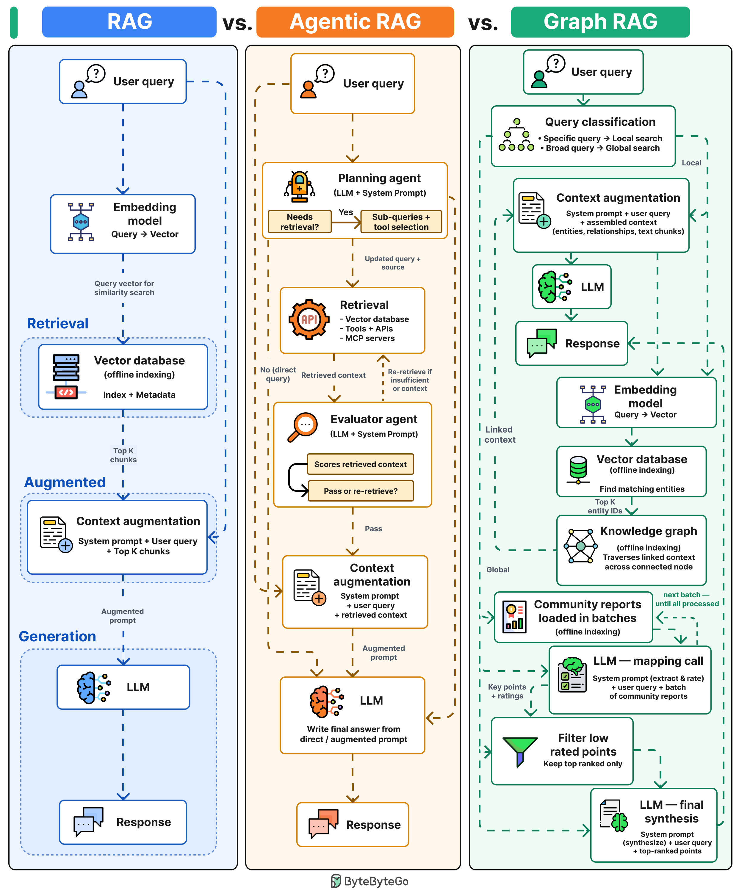
*Comprehensive comparison matrix covering query complexity, indexing cost, traversal mechanics, and evaluation metrics.*

---

## 5. How Airtable Built the Search Layer Behind Their AI Features
{: .d-inline-block }
27 May 2026
{: .label .label-purple }

**Architectural Summary:**  
Explains how Airtable architected a multi-tenant vector search system on Milvus across hundreds of thousands of customer bases, leveraging per-base partitioning, DiskANN SSD-resident vector indexing, and dynamic hot/cold partition offloading to achieve p99 <500ms retrieval without paying continuous in-memory RAM costs for 75% idle bases.

### Key Diagrams

#### Multi-Tenant Partitioning Strategy
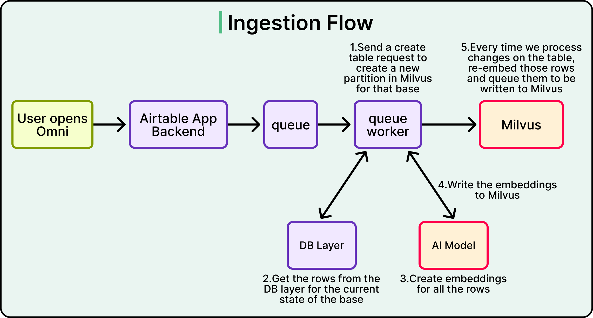
*Isolating customer data by provisioning dedicated collection partitions per table and workspace within shared Milvus clusters.*

#### Cluster Sharding Hierarchy
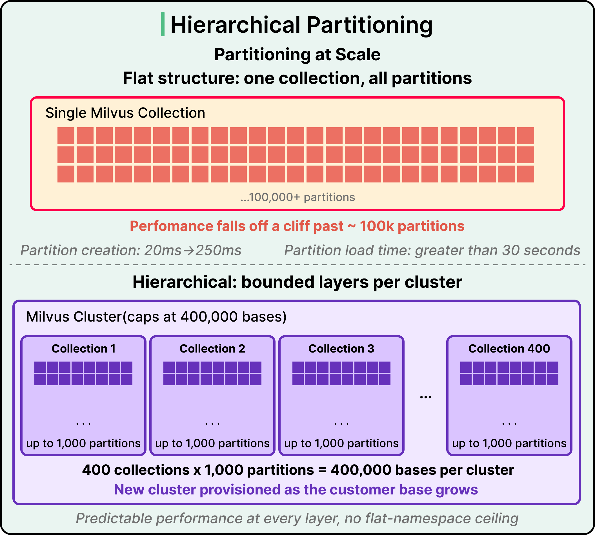
*Physical topology showing stateless query proxies, partition-aware routing, and distributed data nodes.*

#### End-to-End Query Execution Flow
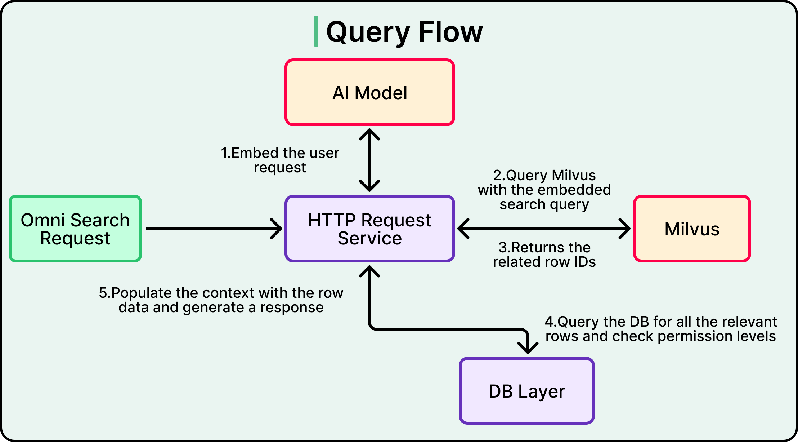
*Proxy authentication -> targeting designated partition -> parallel vector scan -> reciprocal rank fusion.*

#### DiskANN SSD-Resident Indexing vs. HNSW RAM
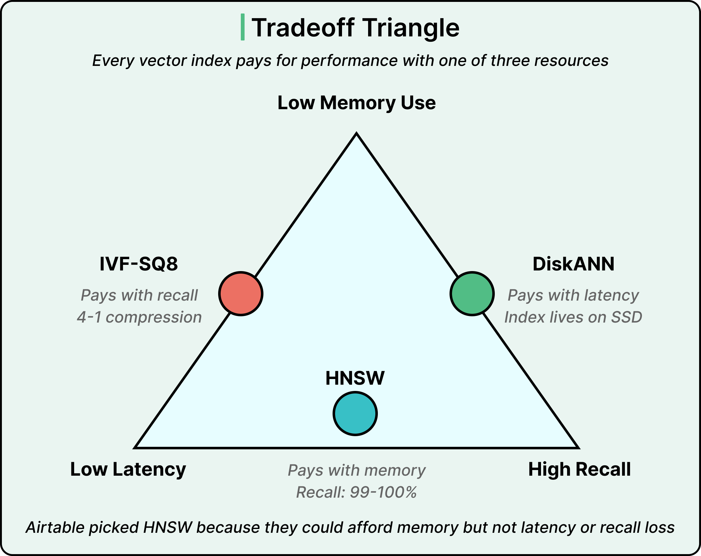
*Trading minimal disk I/O latency for 80% reduction in high-cost server RAM footprints.*

#### Hot/Cold Partition Tiering
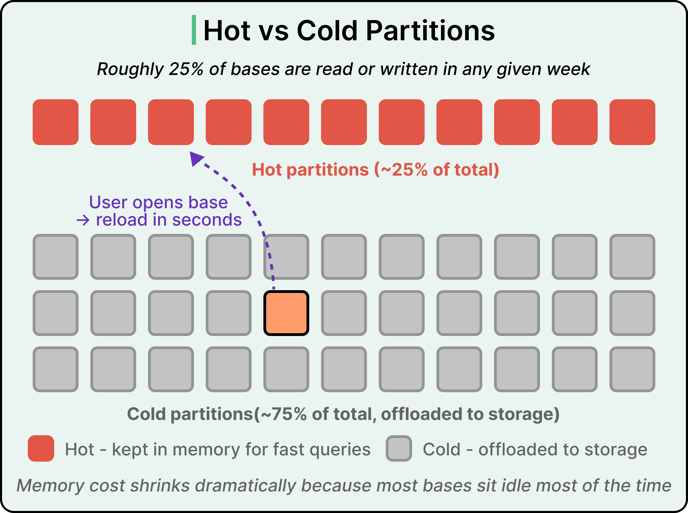
*Dynamically offloading dormant workspace partitions to S3 object storage and loading them back on demand.*

---

## 6. How CockroachDB Built Vector Indexing at Scale
{: .d-inline-block }
25 May 2026
{: .label .label-blue }

**Architectural Summary:**  
Details C-SPANN, CockroachDB's distributed vector indexing engine designed to eliminate central coordinators and massive RAM requirements by embedding a hierarchical centroid clustering tree directly into SQL table storage, automatically leveraging CockroachDB's native range sharding, Raft replication, and ACID guarantees.

### Key Diagrams

#### Vector Space vs. Distributed SQL Constraints
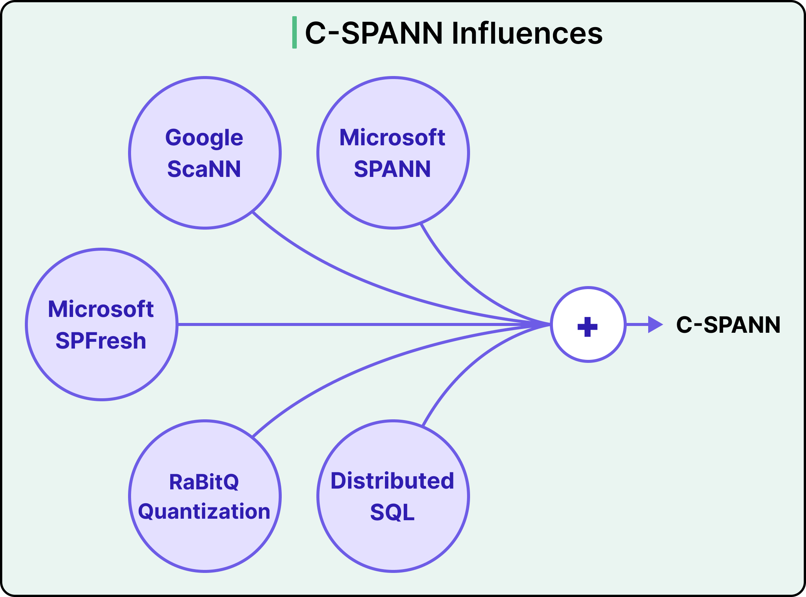
*Architectural hurdles: Scaling approximate nearest neighbor (ANN) search across shared-nothing distributed SQL nodes.*

#### The C-SPANN Tree Architecture
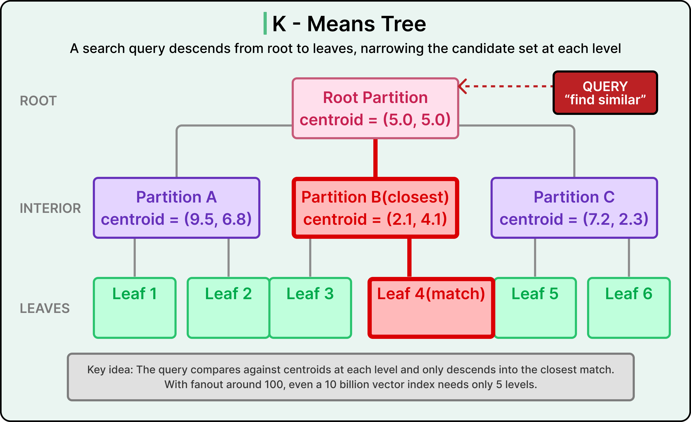
*Hierarchical centroid clustering structure (fanout ~100) enabling localized index navigation.*

#### Vector Partitions as Native SQL Key-Value Rows
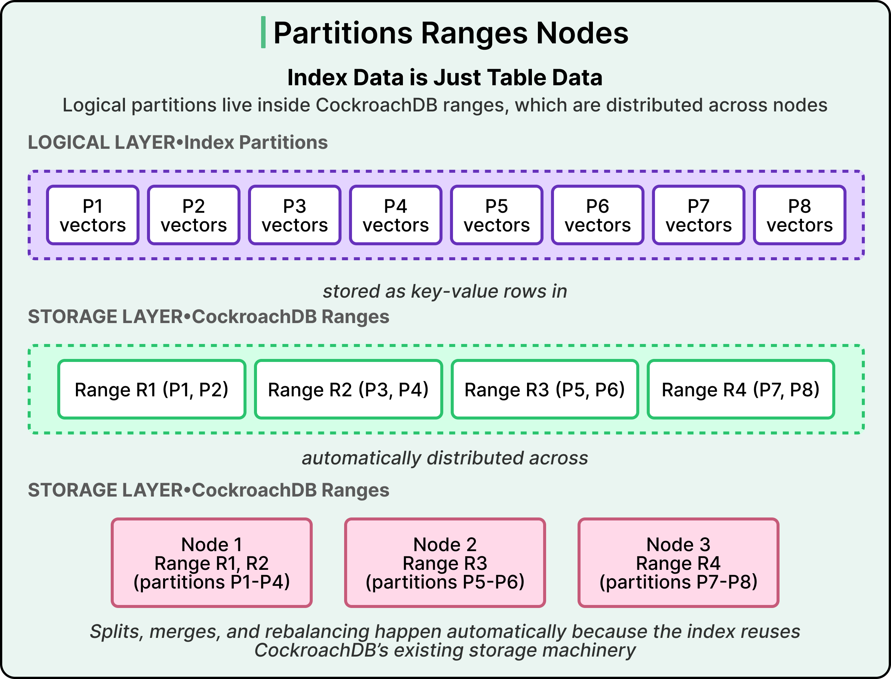
*Encoding high-dimensional vector centroids directly as ordered keys in RocksDB/Pebble storage engines.*

#### Automatic Range Sharding & Raft Consensus
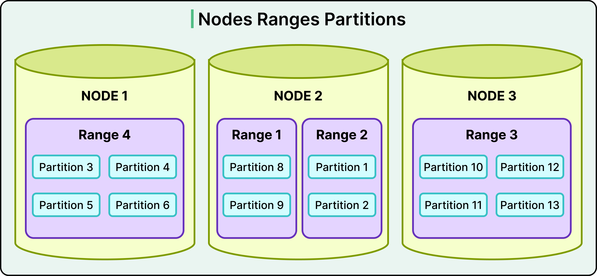
*Vector index partitions split, balance, and replicate automatically across clusters using existing SQL Raft groups.*

---

## 7. EP216: RAGs vs Agents
{: .d-inline-block }
23 May 2026
{: .label .label-yellow }

**Architectural Summary:**  
Contrasts the single-turn, low-cost grounding architecture of RAG (embed -> vector retrieve -> context inject -> generate) against the multi-turn dynamic feedback loop of AI Agents (reason -> tool dispatch -> syscall execution -> observe -> reflect), clarifying the performance, latency, and error-drift trade-offs between them.

### Key Diagrams

#### Linear Grounding vs. Dynamic Execution Loop
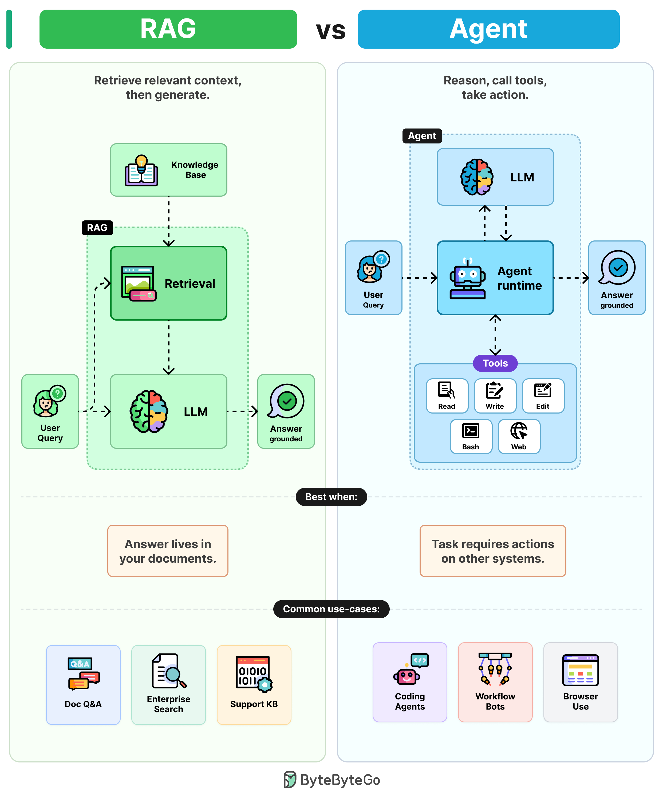
*Architectural split: Passive read-only context retrieval vs. active environment mutation via tools.*

#### Request Lifecycle Through an Agent Runtime
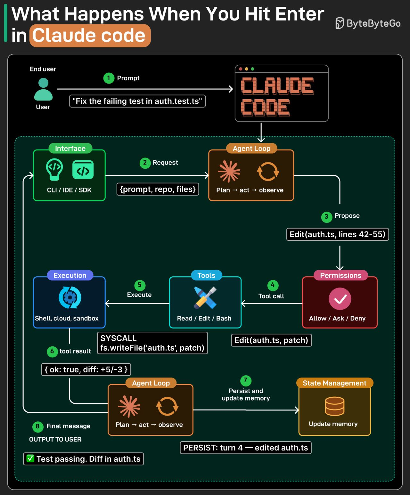
*Step-by-step traversal: User prompt -> Plan validation -> Permission enforcement -> Shell/API tool execution.*

---

## 8. How Agentic RAG Works?
{: .d-inline-block }
23 Mar 2026
{: .label .label-purple }

**Architectural Summary:**  
Replaces rigid one-way RAG pipelines with an iterative control loop where an agentic coordinator actively evaluates retrieval quality, rewrites ambiguous queries, routes sub-questions across diverse data sources, and performs self-correcting validation before generating the final response.

### Key Diagrams

#### Standard Linear Pipeline vs. Agentic Loop
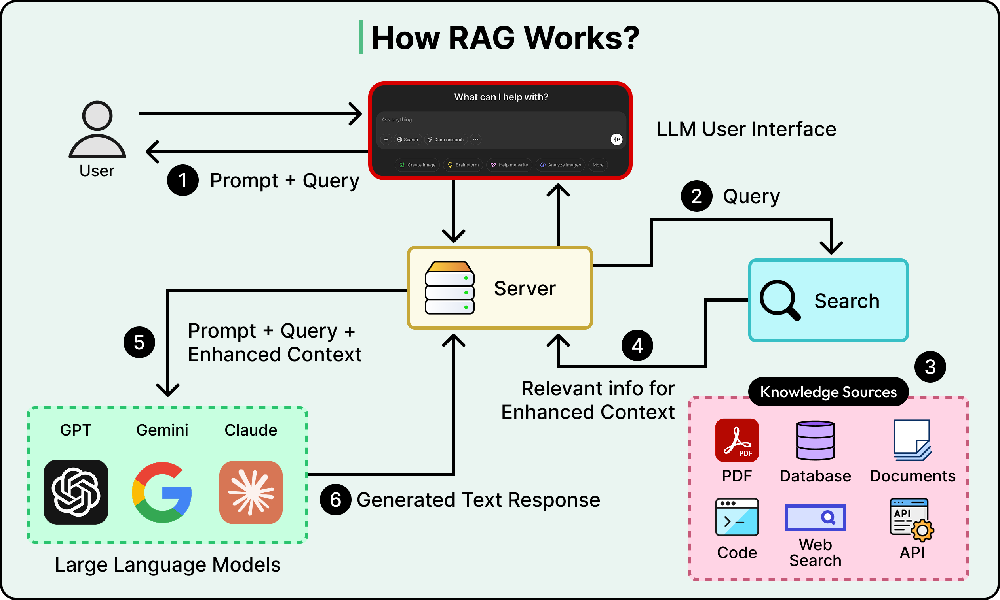
*Rigid single-pass pipeline failing when queries require multi-step reasoning or disambiguation.*

#### Shift to Active Control Loop
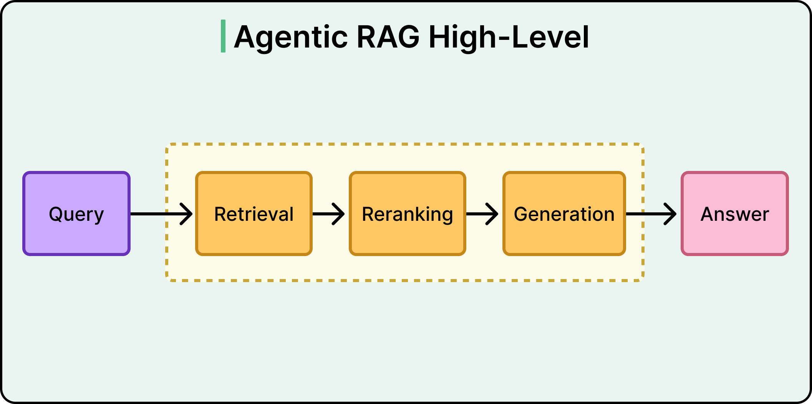
*Introducing self-reflection, retrieval validation, and iterative re-querying into retrieval workflows.*

#### Agentic RAG High-Level System Architecture
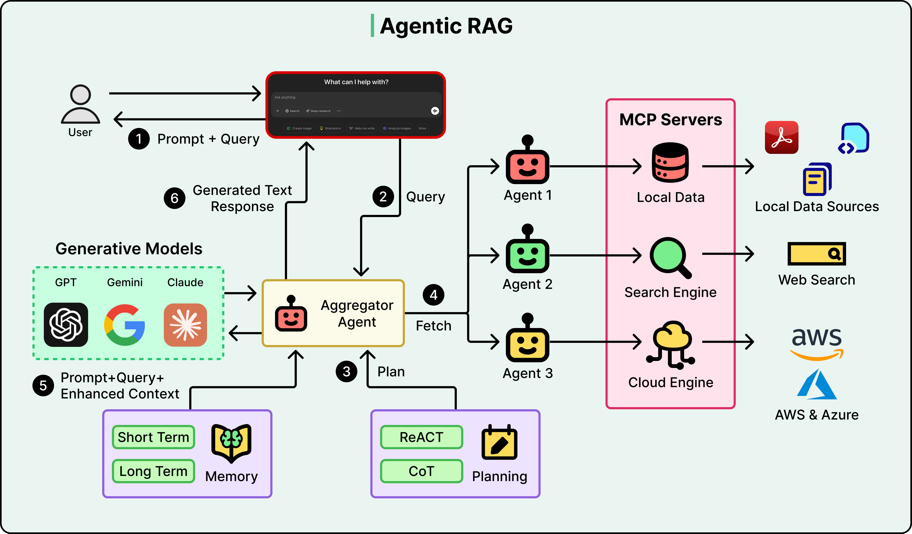
*Full topology: Query Decomposer -> Source Router -> Vector/Web Retrievers -> Document Grader -> Generator -> Hallucination Verifier.*

#### Query Refinement & Routing Cycle
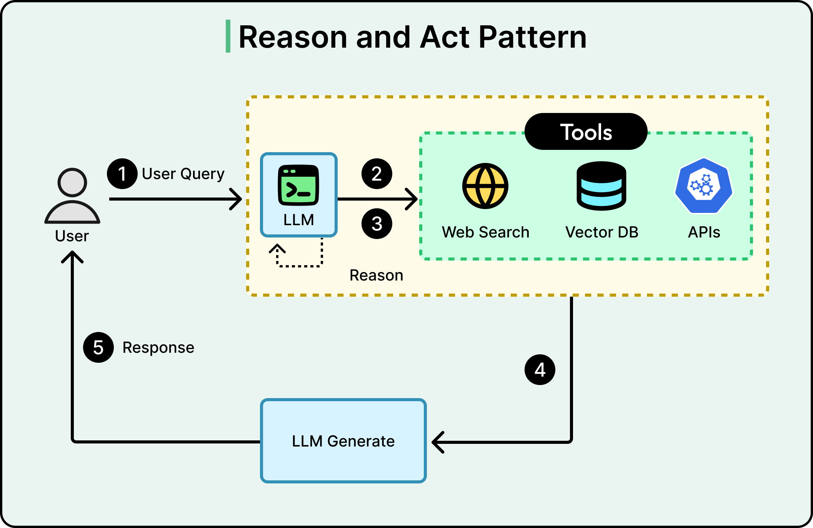
*Decomposing complex queries into discrete sub-questions dispatched to specialized internal or external indexes.*

---

## 9. Dropbox Multimedia Search: Making File Search More Useful
{: .d-inline-block }
09 Dec 2025
{: .label .label-blue }

**Architectural Summary:**  
Details the architecture powering Dropbox Dash’s multimedia search across billions of images and videos, combining an asynchronous multimodal indexing pipeline (extracting EXIF, transcripts, and CLIP embeddings) with geolocation-aware hybrid vector retrieval and just-in-time thumbnail generation to manage petabyte-scale storage costs.

### Key Diagrams

#### Overall Multimedia Search Architecture
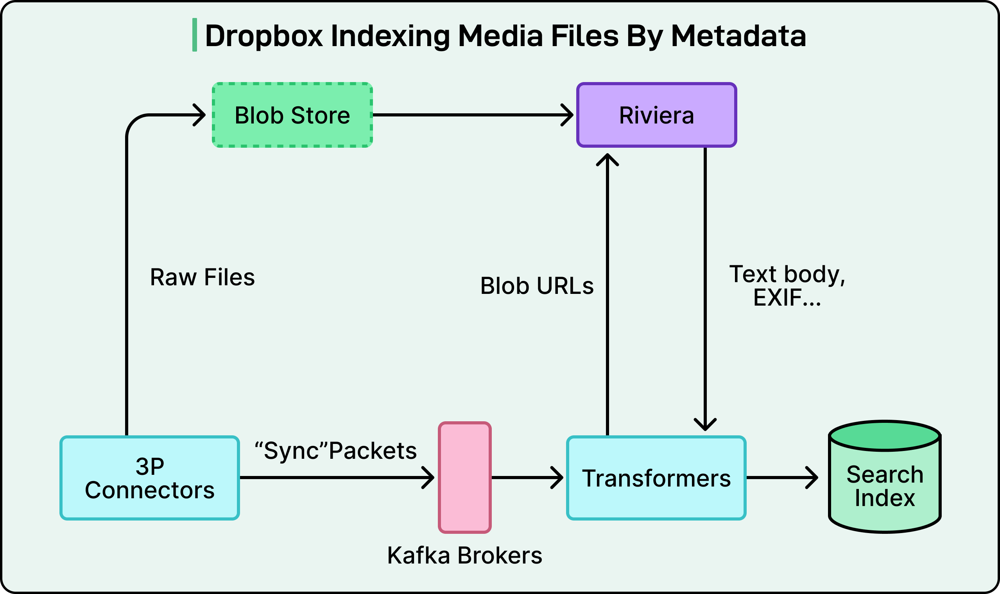
*System architecture combining offline batch feature extractors, multimodal vector indexes, and online query engines.*

#### Metadata & CLIP Embedding Indexing Pipeline
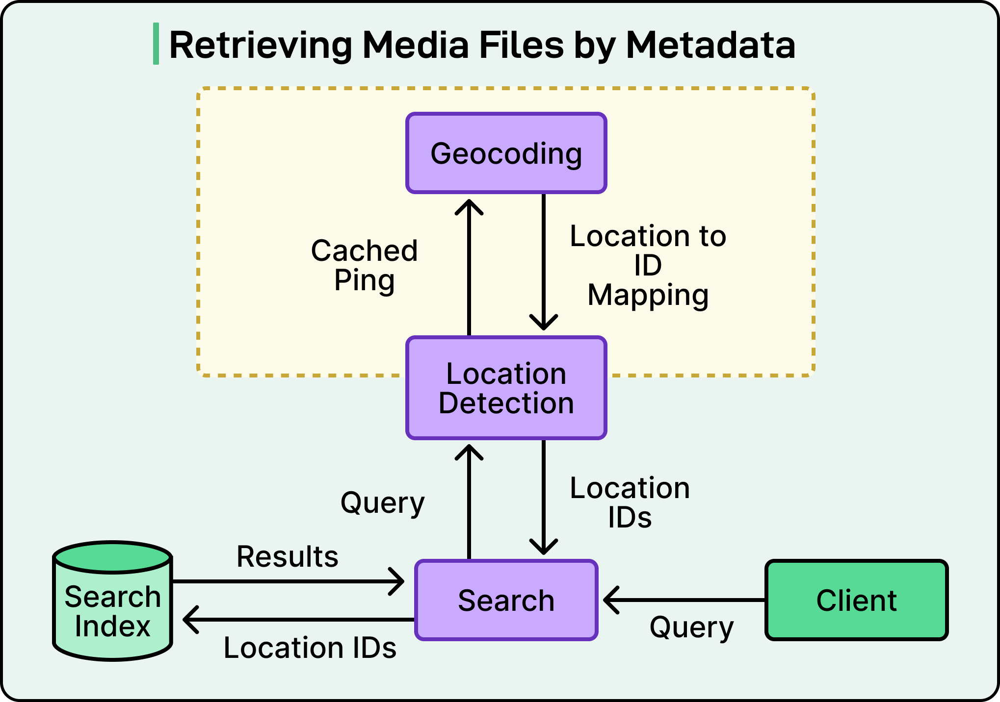
*Asynchronous pipeline extracting EXIF timestamps, audio speech-to-text transcripts, and CLIP visual vectors.*

#### Geolocation-Aware Retrieval System
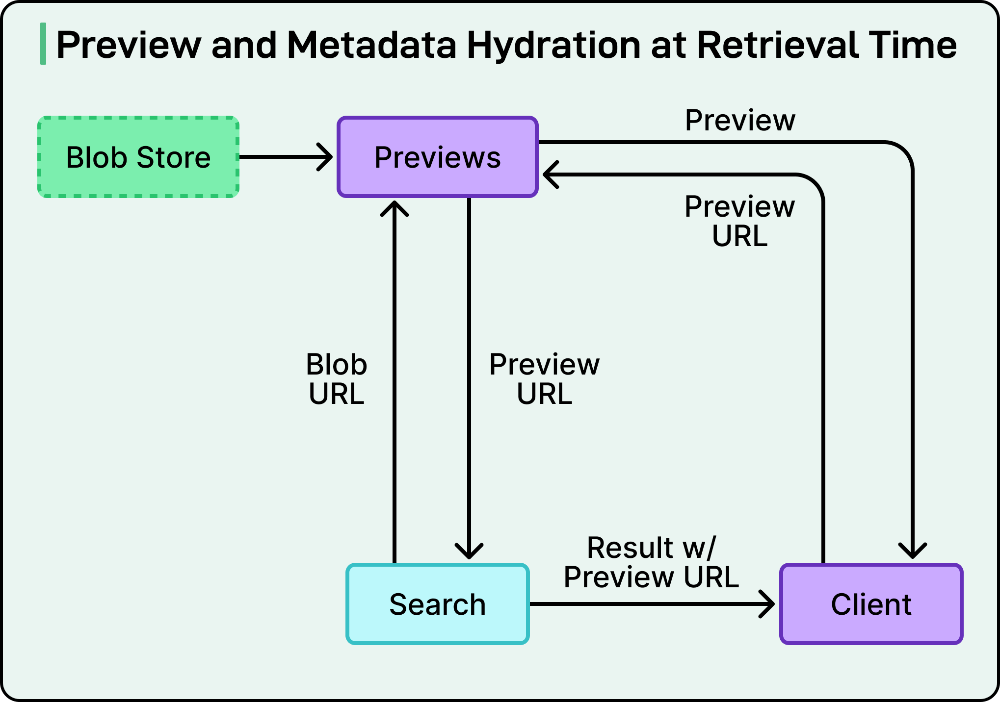
*Combining spatial bounding box filters with dense vector semantic search for contextual media discovery.*

---

## 10. How RAG Enables AI For Your Data
{: .d-inline-block }
23 Sep 2025
{: .label .label-green }

**Architectural Summary:**  
Establishes the foundational end-to-end RAG architecture—solving training cutoffs, hallucinations, and private data isolation—by decomposing the pipeline into document preparation (smart chunking and overlap), dense vector embedding generation, vector database indexing, and query-time context augmentation.

### Key Diagrams

#### Foundational RAG Overview
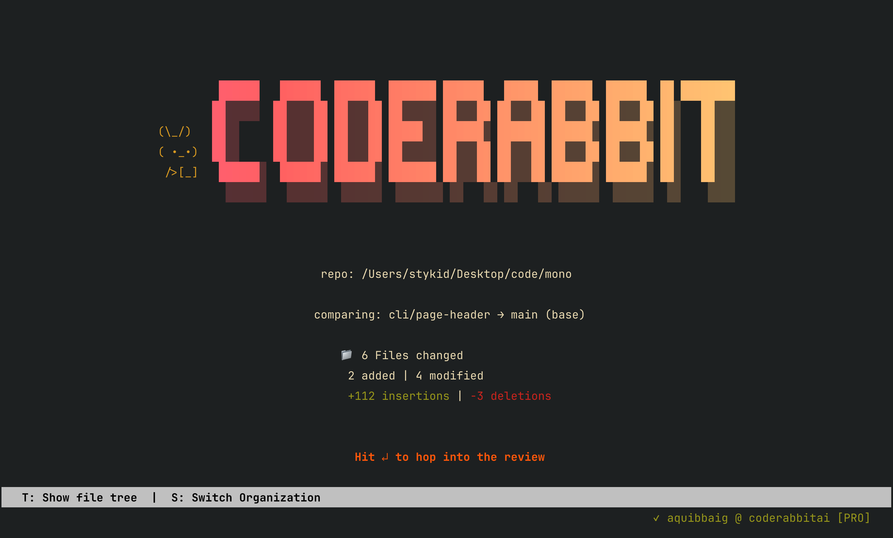
*Complete overview infographic mapping document ingestion, vector storage, and prompt augmentation.*

#### Document Ingestion & Chunking Strategies
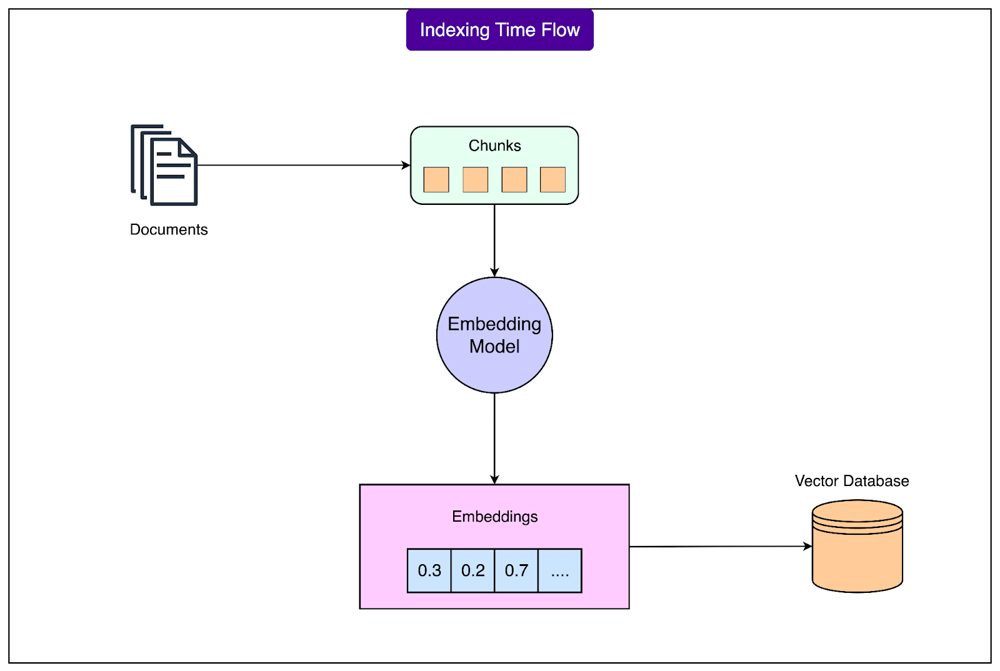
*Analysis of chunk sizes, sentence-boundary splitting, and sliding window overlaps.*

#### Embedding Generation & Vector Storage
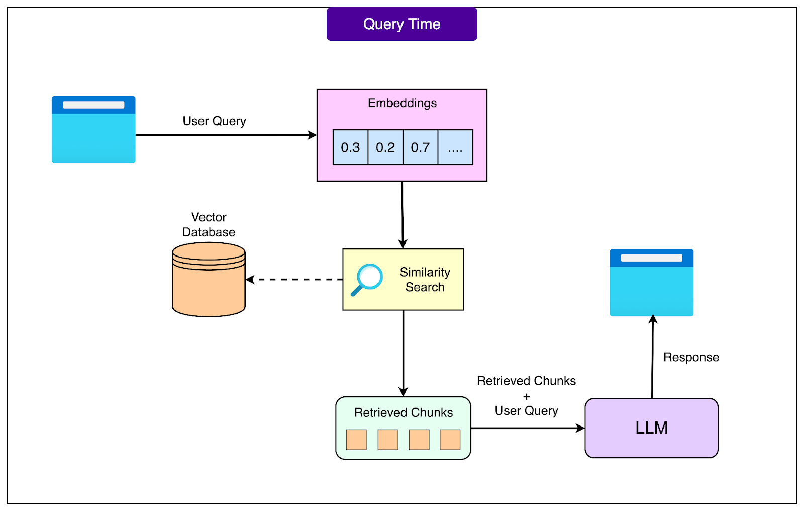
*Converting text chunks into dense floating-point vector representations stored in ANN vector indexes.*

#### Query Execution & Augmented Generation
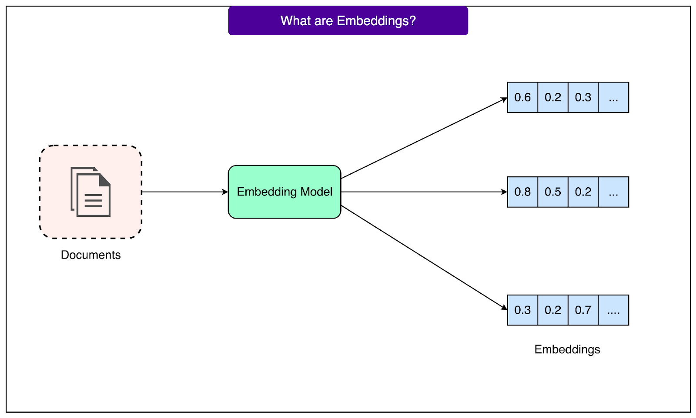
*Injecting top-k retrieved chunks into the prompt context window to ground LLM generation.*

---

## 11. How Dropbox Built an AI Product Dash with RAG and AI Agents
{: .d-inline-block }
02 Sep 2025
{: .label .label-purple }

**Architectural Summary:**  
Explores the architecture of Dropbox Dash, uniting enterprise-wide cross-platform RAG with autonomous AI agents to index emails, documents, calendars, and chats while enforcing strict tenant access control lists (ACLs) and executing agent actions inside a custom secure interpreter.

### Key Diagrams

#### Dropbox Dash Enterprise RAG + Agents
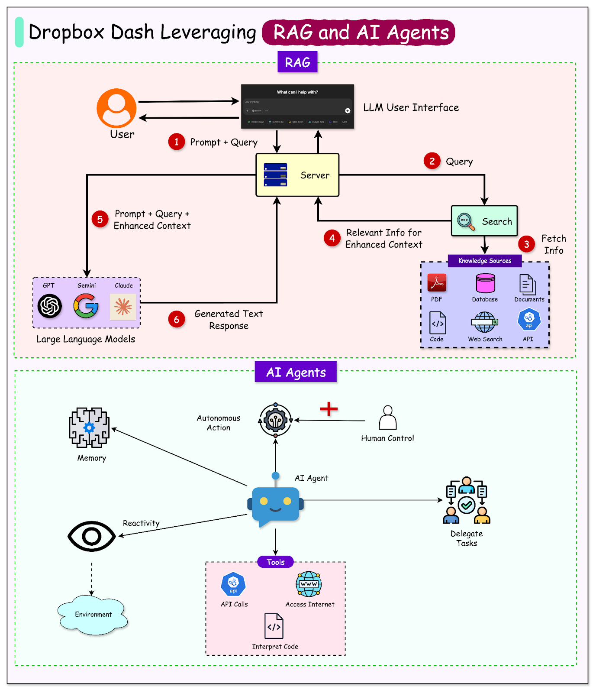
*System topology integrating multi-platform enterprise SaaS connectors with agentic reasoning.*

#### Enterprise Access Control Lists (ACLs)
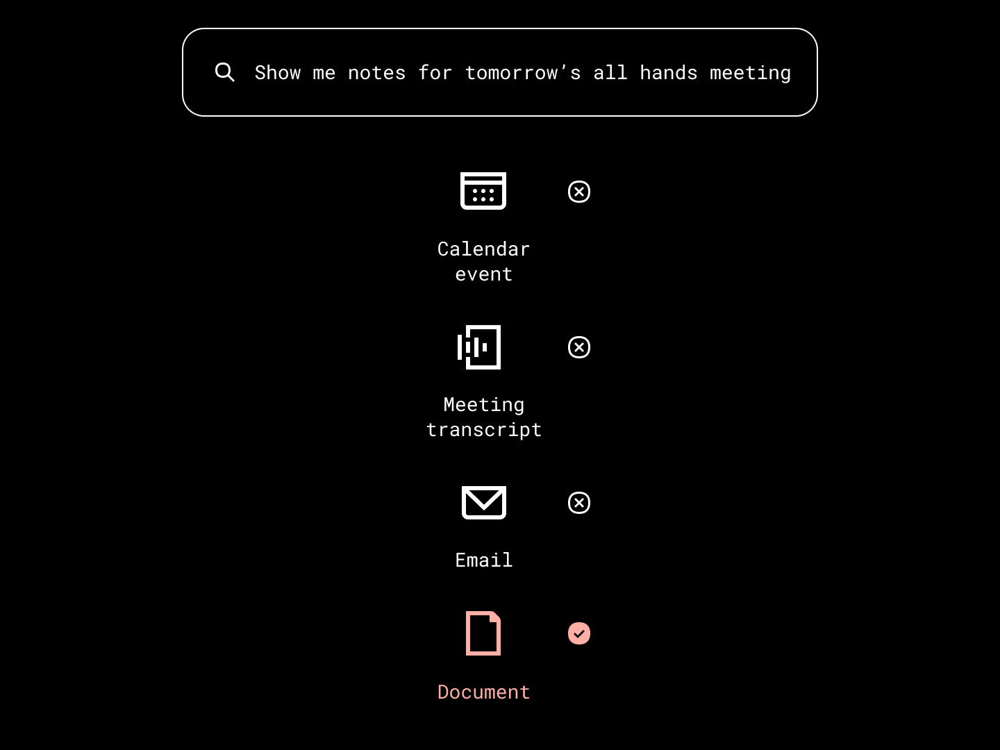
*Enforcing strict data access permissions during vector retrieval to prevent data leaks between employee roles.*

#### Sandboxed Interpreter Execution Architecture
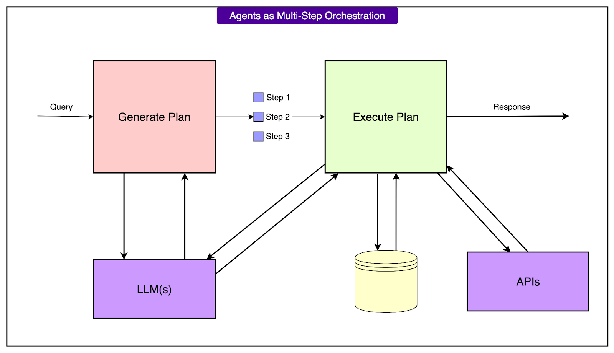
*Secure containerized environment for executing LLM-generated code and tool mutations with audit logs.*

---

## 12. EP169: RAG vs Agentic RAG
{: .d-inline-block }
28 Jun 2025
{: .label .label-yellow }

**Architectural Summary:**  
Contrasts static RAG architectures (linear retrieve-and-read pipelines vulnerable to query ambiguity) against Agentic RAG (incorporating query routing, iterative sub-question decomposition, multi-document retrieval, and automated answer validation).

### Key Diagram

#### Static RAG vs. Agentic Control Architecture
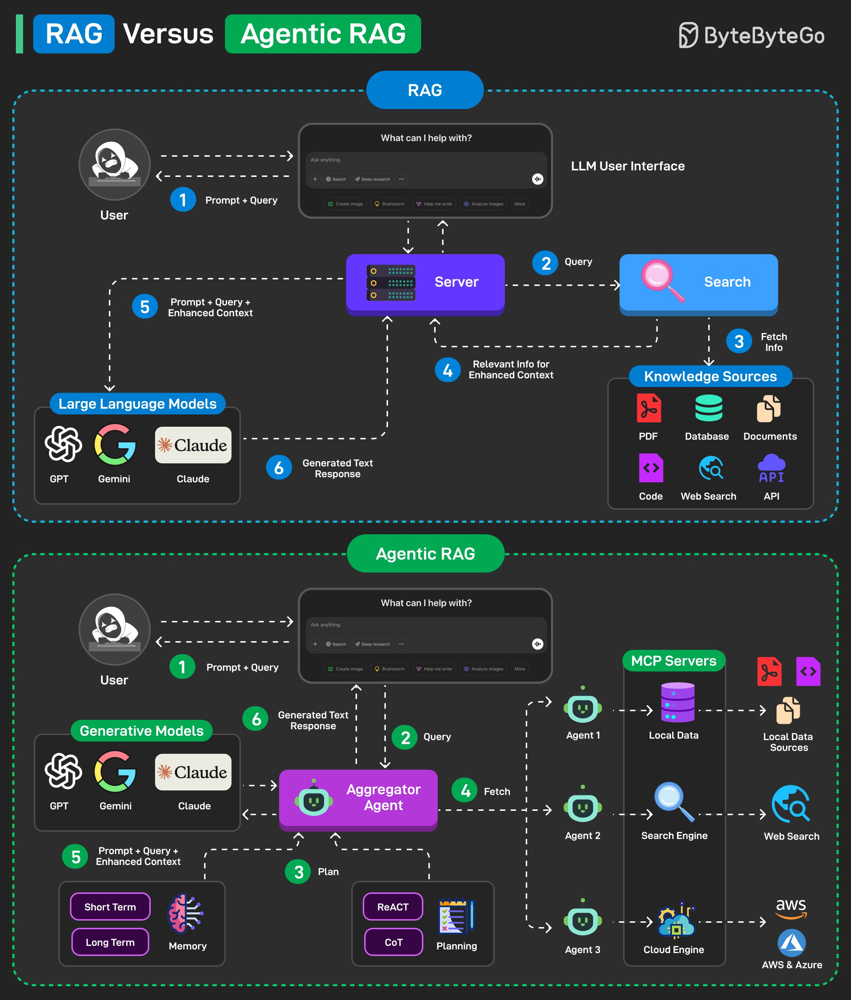
*Architectural comparison highlighting router, reflection, and iterative retrieval stages.*
